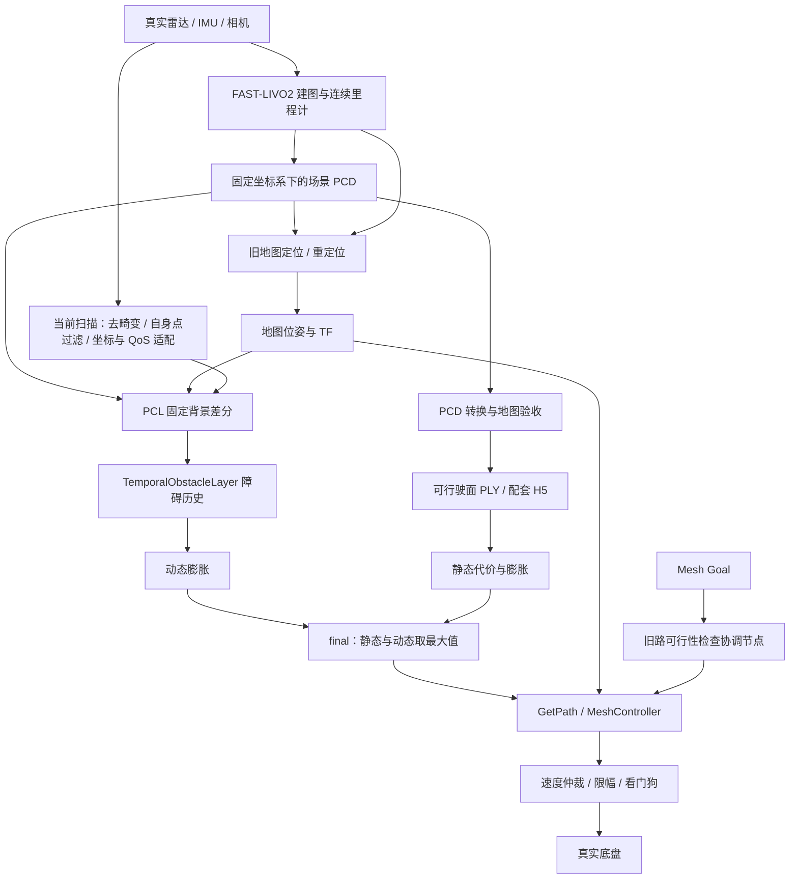

# FAST-LIVO2 → PCL 背景差分 → STVL 时间层 → MeshNav：sim2real 指南

更新：2026-10-11。依据本仓库 `6a45dc4` 及当日读取的源码编写；配套参考包与补丁见 `doc/sim2real_templates/`。

文档位于仓库根目录 `/home/rainple/nav_test`；ROS 2 工作空间为其下的 `mesh_nav_ws`。本文只讨论 MeshNav + MeshController，不涉及其他导航框架。

**目标：先证明建图、定位、障碍感知和底盘接口分别正确，再验证全向导航及“旧路可行就不换路”的行为。换用真机可以排除 Gazebo 渲染、仿真时间和接触模型的影响，但不会自动修复地图、向量场或重规划代码的问题。**

主线是 **PCL 背景差分 → TemporalObstacleLayer → 动态膨胀 → final → MeshController → command_gateway → 底盘驱动**。本次提供可暂存构建的独立实车参考包、PCL 补丁、资产校验与无硬件检查工具。仿真源码和参数继续保留；FAST-LIVO2/实际定位与设备驱动按标准接口接入。

**要按步骤动手，先执行第 8 节。** 第 3～7 节供填写地图、外参和实测参数时查阅，第 9～10 节用于实车验收与记录。

| 阶段 | 操作入口 | 完成后留下什么 |
|---|---|---|
| 电脑改造 | 8.2～8.3 | 可独立构建、无 Gazebo 依赖的导航包与网关 |
| 电脑配置 | 8.4～8.5，参照 3～7 | 版本化 bundle、实测参数、标准话题/TF 契约 |
| 电脑检查 | 8.6、8.12 | 假硬件启动、规划与故障停车的软件证据 |
| 部署 | 8.9～8.11 | 安装包/源码、地图和配置；实车只接驱动接口 |
| 车辆验收 | R0～R9 | 真实定位、障碍、制动与导航结果 |

硬件未知项明确保留在接口表里；默认值和模拟输入不会被当作真实车辆测量。

## 0. 先整理项目，保留可复现的仿真

### 0.1 当前清理状态与保留清单

本次检查时，旧顶层 `mesh_navigation/`、完整 STVL 参考仓库和 DDDMR 依赖目录已不在项目中。实际工作空间是 `mesh_nav_ws/`，其 `src/mesh_navigation/` 必须保留。`field/` 和 `field/pcd/rmuc2026_field.pcd` 当前存在；不要继续按此前临时缺失的状态操作。

| 路径或内容 | 操作 | 原因 |
|---|---|---|
| `mesh_nav_ws/src/` | 保留 | 当前导航、地图、控制、定位和仿真源码 |
| `src/mesh_navigation/mesh_layers/src/stvl_frustum/` | 保留，含许可证和 `UPSTREAM.md` | 正在编译的三个上游几何文件；不需安装整个 STVL/OpenVDB |
| `src/pb_vehicle_adapter/`、`src/mesh_navigation_tutorials_sim/`、`src/pb_gazebo_sim_support/` | 保留 | 仿真入口、车辆、场地与插件；协调节点也在 PB 包中 |
| `third_party/pb2025_sources/`、`pb2025_install/`、`pb2025_build/` | 一起保留 | 已安装 PB 插件是指向 build 内 `.so` 的绝对软链接，不能只删 build |
| `third_party/pb2025_python/`、`pb2025_tools_venv/` | 保留 | 重新生成 PB 模型时使用 |
| `field/pcd/rmuc2026_field.pcd`、当前 PLY、场地碰撞/视觉 STL | 保留并单独备份 | PCL 固定背景与现有仿真依赖 |
| `field/pcd_to_nav_mesh.py`、`check_nav_mesh_route.py`、`requirements-conversion.txt` | 保留 | 实车 PCD 转导航网格与预检工具 |
| `field/` 中 CAD、重复的原始 PCD、旧分析产物 | 确认引用后归档 | 体积大；不能整目录删除，里面仍有仿真资源 |
| `log/`、`__pycache__/`、`.pytest_cache/` | 保存有价值记录后清理 | 可再生成 |
| 工作空间 `build/`、`install/` | 暂时保留；需要时一起停机重建 | 保留可启动基线；迁移到另一台机器则重新编译 |
| `.git/`、`validation/`、STVL 实施状态文档 | 保留 | 版本与回归证据 |

注意表中的 `src/` 均相对于 `mesh_nav_ws/`。不要用全项目 `find ... -name build` 批量删除；PB 的 build 目录目前是运行依赖。

### 0.2 先备份，再处理残留引用

停掉仿真与导航后，在项目外建立备份。以下是操作示例，本次文档更新没有执行这些命令：

```bash
export REPO="${REPO:-$HOME/nav_test}"
cd "$REPO"
backup_dir="${REPO}_backup_$(date +%Y%m%d_%H%M%S)"
mkdir -p "$backup_dir"
git status --short > "$backup_dir/git-status.txt"
git diff --binary HEAD > "$backup_dir/worktree.patch"
git rev-parse HEAD > "$backup_dir/project_commit.txt"
tar -czf "$backup_dir/source-and-config.tgz" \
  mesh_navigation_tutorials/src mesh_navigation_tutorials/launch \
  mesh_navigation_tutorials/validation \
  mesh_nav_ws/STVL_MESHNAV_IMPLEMENTATION_PLAN.md \
  mesh_nav_ws/STVL_MESHNAV_IMPLEMENTATION_STATUS.md \
  tools doc/sim2real_templates SIM2REAL指南.md
```

**Git 没有备份所有运行资产。** `.gitignore` 忽略 PCD、H5、STEP、部分 STL、转换产物及 diagnostics。上述源码压缩包也不包含全部 `field/` 和 `third_party/`。另将当前背景 PCD、地图原件、标定、场地 STL、PB 依赖和重要 bag 复制到外盘，并记录 `sha256sum`。`git restore` 无法恢复从未提交的文件。

以下是原仿真/历史分支的待清理项，不是第 8 节纯实车闭包的前置条件：

1. `pb_vehicle_adapter/package.xml` 仍声明已移除的 `octo_planner`、`jie_octomap`。移除这两个依赖，并核查 JIE/DDDMR 分支对应的 console entry、源码、配置和测试。`setup.py` 中 `pb_dddmr_map_publisher`、`pb_pcd_publisher` 仍指向当前不存在的模块，应一起整理；保留 `meshnav_navigator` 与仿真入口。
2. `third_party/build_dddmr_native.sh`、`setup_dddmr_env.sh`、DDDMR 专用 patch 可随历史项目归档。不要运行仍指向不存在工作空间的环境脚本。
3. 根 README、`field/README.md`、PB README 还有旧 `doc/*`、`meshnav_demo_ws`、JIE/DDDMR 步骤。逐一更新这些入口；`field/verify_rmuc_project.py` 也仍按旧目录组织检查，当前不能把它当作总验收命令。

先查看引用，再决定归档范围：

```bash
rg -n 'octo_planner|jie_octomap|dddmr|meshnav_demo_ws' \
  mesh_nav_ws/src/pb_vehicle_adapter tools third_party \
  README.md field/README.md
ls -l third_party/pb2025_install/rmoss_gz_plugins/plugins/
test -s field/pcd/rmuc2026_field.pcd
```

### 0.3 仿真与实车配置分开

现有 `mbf_mesh_nav.yaml`、PCL YAML 和 `pb_vehicle_profile.yaml` 继续服务仿真。第 8 节把独立实车包暂存到 `src/`，使用 `build-real` / `install-real` 和外部场地 bundle；实车配置不覆盖仿真 YAML。

当前仿真总入口 **没有启动 PCL 差分节点**：默认 `obstacle_segmentation: rmcl_seg` 启动的 RMCL 发布 `/obstacle_points`，时间层订阅的却是 `/dynamic_obstacles`。使用本文主链时，应另开终端启动 PCL；若不使用 RMCL 分割，可将仿真配置中的 `meshnav_launch.obstacle_segmentation` 改为 `none`。定位选择 `rmcl_micpl` 时仍需保留 RMCL 定位。一个障碍输入话题只安排一个已验收的来源。

```bash
# 终端 A：保留原 PB 仿真入口。
source /opt/ros/humble/setup.bash
source /home/rainple/nav_test/mesh_nav_ws/install/setup.bash
ros2 launch pb_vehicle_adapter meshnav_pb_sim.launch.py
```

```bash
# 终端 B：PCL 仿真差分；先确认当前背景 PCD 与 Gazebo 场地对齐。
source /opt/ros/humble/setup.bash
source /home/rainple/nav_test/mesh_nav_ws/install/setup.bash
ros2 launch pcl_obstacle_point_subtraction pcl_obstacle_point_subtraction.launch.py
```

启动后核查 `/cloud`、`/dynamic_obstacles` 和 final 代价更新，再做原场景的箱体出现、遮挡、移走与绕行回归。`pb_preflight` 的通过不能单独证明 PCL 差分与时间层清除正确。`start_sim: "False"` 表示沿用已有仿真，仍会切换 PB 速度来源，不能作为实车模式。

## 1. 当前具备什么，还缺什么

| 项目 | 当前状态 | 真机工作 |
|---|---|---|
| PCD → 可行驶面 PLY | 已有 `field/pcd_to_nav_mesh.py` | 使用真实场地 PCD，按车辆能力重新验收 |
| MeshNav 网格、静态/动态代价层 | 已有，动态输入使用 `TemporalObstacleLayer` | 切换地图、缓存、车体参数和真实时钟 |
| PCL 固定背景差分 | 已有 KD 树缓存；本次提供可应用的严格输入/背景检查及原点/QoS 补丁 | 按 8.2 应用补丁，再填真实背景与测量值 |
| STVL 时间衰减 | 已有线性/指数/持久模型与视野加速 | 是 MeshNav 适配实现，未移植整个 STVL，也没有完整自由空间/遮挡判定 |
| MeshController 全向控制 | 已有，`holonomic: true` | 校验 vx、vy、wz 的方向、单位与底盘能力 |
| 旧路保留协调节点 | 提供独立 `meshnav_runtime` 快照，受阻后取消旧执行并停车重试规划 | 验证真实停止与路径接替 |
| FAST-LIVO2 驱动、外参、时间同步 | 本次未提供实际部署版本 | 现场确认并冻结配置 |
| 重启后对旧地图定位 | 本仓库未提供 FAST-LIVO2 的完整接入 | 需要实际定位模块，或经验证的短时初始化方案 |
| 真机里程计/TF 适配 | 不能用 Gazebo 真值代替 | 由实际里程计、定位节点和标定外参提供 |
| 真实底盘速度接口与停止机制 | 提供默认禁能的 `command_gateway` 参考实现 | 对接驱动/仲裁与健康心跳，实测驱动独立失联停车 |
| 真机总 launch | 提供独立 `meshnav_real_bringup`、完整 YAML、bundle 校验及假硬件工具 | 暂存构建后按标准接口接入设备 |

参考包位于文档目录，尚未自动安装到当前活动工作空间。第 8 节给出一次暂存脚本与明确的测量项；标准 ROS 边界之外的驱动协议、定位与标定按实际设备提供。

当前导航配置快照：投影高度 **0.50 m**，静态/动态内圈 **0.15/0.30 m**，动态外圈 **0.60 m**，线速度上限 **0.8 m/s**；PCL 背景匹配阈值 **0.08 m**。动态内圈的旧注释仍提到 0.40 m，与实际数值不符；`obstacle_inflation.inscribed_value: 0.99` 也与 `mesh_planner.cost_limit: 0.99` 相等，不能把它当成留有阈值余量的实车设置。**这些均是当前仿真配置，不是实车推荐参数。** 后续以实际参数回读、测量和路线验收为准。

### 1.1 先填现场信息

| 内容 | 现场填写 |
|---|---|
| FAST-LIVO2 仓库 URL、分支、commit；ROS 1 / ROS 2 | 待填 |
| 上位机系统、ROS 发行版、CPU/GPU、是否分布式 | 待填 |
| 雷达型号、驱动版本、点云格式、时间戳来源 | 待填 |
| IMU、相机、内参、外参、同步方式 | 待填 |
| 整车含附件的长 L、宽 W、最高碰撞高度 H | 待填，单位 m |
| 前后左右突出物、雷达/相机是否高于车顶 | 待填 |
| 最大允许坡度、可跨台阶、最小实测刹车减速度 | 待填 |
| 底盘命令话题、消息类型、参考坐标系、失联超时 | 待填 |
| 实际里程计话题、pose/twist 坐标、是否发布 TF | 待填 |
| 地图定位方案、初始位姿输入方式、失效判据 | 待填 |

未确认 FAST-LIVO2 版本时，不能照搬某个 ROS 2 分支的 launch 名字。官方当前 README 使用 catkin 和 `roslaunch`，属于 ROS 1 用法；你们若使用 ROS 2 移植版，应以该仓库为准。[FAST-LIVO2 官方说明](https://github.com/hku-mars/FAST-LIVO2)

## 2. 总体流程与接口



地图有不同用途，必须区分：

- **场景 PCD**：保存地面、墙、柱、天花板等结构，用于检查建图与旧地图定位。
- **固定背景 PCD**：PCL 差分的参照，必须与导航 map 对齐，建图中的临时物体应剔除。可以来自场景 PCD，但要单独验收；背景中已有的物体不会因为再次扫描而变成差异点，其固定碰撞约束还需由导航地图/静态代价表达。
- **导航 PLY**：机器人能够行驶的表面。不能把墙、顶棚直接当作行驶面。
- **H5**：MeshNav 的工作缓存，依赖 PLY 和代价参数；不提供 SLAM 重定位。
- **当前扫描**：实时障碍输入。不能用累计建图点云替代，否则移动物体会留下历史点。

### 2.1 约定导航侧接口

以下名称是本文模板约定，真实驱动通过适配或 remap 接入。/nav/cmd_vel 是固定的内部导航输出，其余外部接口按 8.7 配置。

| 接口 | 类型 | 约束 |
|---|---|---|
| `/cloud` | `sensor_msgs/msg/PointCloud2` | 当前扫描，XYZ 属于配置的 `lidar_frame`；采样时间有效；参考实车 PCL 输入订阅 BestEffort，KeepLast(1) |
| `/dynamic_obstacles` | `sensor_msgs/msg/PointCloud2` | PCL 差分输出，Reliable、队列深度 1；frame 为 `base_footprint`，保留采样时间；正常无障碍也发布有效空帧 |
| `/obstacle_points` | `sensor_msgs/msg/PointCloud2` | 仅选择 RMCL 分割时使用；需改时序层 topic 或将分割输出 remap 到 `/dynamic_obstacles` |
| `/odom` | `nav_msgs/msg/Odometry` | 连续里程计，必须提供可信实际速度，不能只有 pose、twist 全为零 |
| `/tf`、`/tf_static` | TF | `map` 到导航车体参考点、雷达在扫描时间可查询 |
| `/nav/cmd_vel` | `geometry_msgs/msg/TwistStamped` | 本文实车模板将 MBF `~/cmd_vel` remap 到此处；改话题名不会改变消息类型 |
| `/hardware/cmd_vel` | `geometry_msgs/msg/Twist` | 网关最终输出；驱动/仲裁接此接口，按车体参考点执行并独立检测失联 |
| `/hardware/ready`、`/hardware/estop`、`/localization/healthy` | `std_msgs/msg/Bool` | 真实设备/定位健康心跳；缺失或过期禁能，详见 8.7 |
| `/command_gateway/enable`、`/command_gateway/status` | SetBool / String | 显式使能与状态；初始禁能、故障后不自动恢复 |
| `/rviz/goal_pose` | `geometry_msgs/msg/PoseStamped` | `frame_id: map`，目标落在正确层的网格上 |
| `/meshnav_navigator/status` | `std_msgs/msg/String` | JSON：状态、执行路径计数、阻断段等 |

**速度必须经过一个明确的最终发布者。** 遥控、导航、驻停控制不能同时直接写电机命令；底盘侧应在命令过期、急停、导航撤销或定位失效时停止。不能只依赖 ROS 节点正常退出时发出的最后一条零速度。

## 3. FAST-LIVO2 建图

### 3.1 版本与 ROS 环境

推荐保留你们已经验证过的 FAST-LIVO2 建图环境。先记录版本，再决定如何把在线数据接到 ROS 2 Humble：

- **ROS 2 FAST-LIVO2**：可直接按接口对接，检查消息定义、QoS、时间戳和 TF。
- **ROS 1 FAST-LIVO2**：离线 PCD 可以直接复制到本仓库；在线导航还需要桥接标准消息或经过验证的转换进程。不要把“能复制 PCD”当作实时接口已打通。
- `ros1_bridge` 需要可共存的 ROS 1/ROS 2 构建环境。官方说明对 Ubuntu 22.04 + Humble 的组合列出源码构建限制；不能假定当前机器安装一个包就能桥接。优先桥接 `PointCloud2`、`Odometry`、TF 等标准接口；Livox 自定义消息只有在对应接口参与桥接构建后才可能支持。[ros1_bridge 官方说明](https://github.com/ros2/ros1_bridge)

ROS 1、ROS 2 普通工作终端分别加载各自环境；只在专门的桥接终端按桥接工程要求加载两套环境。

建议为建图数据建立独立目录：

```bash
cd /home/rainple/nav_test
mkdir -p field/real/site01_v1/{raw,calibration,reports,mesh}
mkdir -p mesh_nav_ws/diagnostics/real_site01
```

保存软件 commit、驱动配置、FAST-LIVO2 YAML、相机标定和整车传感器外参。后续更换外参、地图坐标或重建地图时使用新的版本目录。

### 3.2 标定与采集

1. 固定雷达、IMU、相机安装，检查支架松动和电机振动；测量雷达到车体导航参考点的外参。
2. 按实际 FAST-LIVO2 版本确认 LiDAR–IMU、LiDAR–Camera 变换的方向，不能仅凭参数名字猜测是正变换还是逆变换。
3. 确认雷达逐点时间、IMU 时间、图像曝光时间处于相容时间基准；跨机器同步系统时钟，记录同步偏差。
4. 按该版本的惯导初始化要求起步；慢速走完整个场地，补扫地面、转角、坡道上下端、隧道内地面。
5. 对关键窄通道从两侧重复采集，覆盖车体将经过的整个宽度，避免仅扫描到墙或顶棚。
6. 尽量减少建图期间的移动物体；保留原始 bag，以便定位误差与地图缺洞可以回放分析。
7. 回到起点检查墙面重影、地面分层及重复经过处的偏差。绕回起点本身不证明系统执行了回环优化。

FAST-LIVO2 的 PCD 导出设置在官方 Avia 示例中包括 `pcd_save_en`、`type`、`filter_size_pcd`、`interval`。其中 `type: 0` 表示世界系输出，`interval: -1` 表示累计保存；具体版本的实际保存行为必须核对源码，不能把这个 Avia 文件整体用于其他雷达。[官方参数示例](https://github.com/hku-mars/FAST-LIVO2/blob/main/config/avia.yaml)

```yaml
# 仅是官方 ROS 1 参数结构示意，不是本项目 ROS 2 参数文件。
pcd_save:
  pcd_save_en: true
  type: 0                 # 地图世界系；不要直接拼接未经位姿变换的 body 系分帧。
  filter_size_pcd: 0.05    # 示例导出分辨率，须按点密度和最小结构尺寸选定。
  interval: -1            # 小场地可用；长时间累计可能占用大量内存。
```

官方当前 `LIVMapper.cpp` 在正常结束循环后调用 `savePCD()`，相关输出包括 `Log/pcd/all_raw_points.pcd`，视觉分支还可能输出降采样文件。因此应正常退出并确认落盘，避免强杀丢失缓存。该源码的默认里程计帧名为 `camera_init` / `aft_mapped`，并有使用发布时间的代码；你们的版本必须实查，不能假设它已经输出导航需要的测量时刻、车体系和速度。[官方发布与保存实现](https://github.com/hku-mars/FAST-LIVO2/blob/main/src/LIVMapper.cpp)

### 3.3 PCD 接收标准

将选定 PCD 复制为：

```text
/home/rainple/nav_test/field/real/site01_v1/raw/site01.pcd
```

随 PCD 写一份 `map_metadata.yaml`，至少记录：

```yaml
site: site01
version: v1
source_frame: 填写建图世界系
navigation_frame: map
units: m
# T_map_slam 把原建图坐标转换到最终导航 map 坐标；以下由标定结果填写。
T_map_slam: 待填写4x4矩阵
slam_commit: 待填
calibration_version: 待填
pcd_sha256: 待填
```

验收内容：米制尺寸、重力方向、地面覆盖、墙厚/重影、关键通道净空、重复经过误差、动态残影。Z 原点可以在传感器初始位置，地面 Z 为负不构成错误；不能为了让地面变成 0 而只移动 PCD，却忘记实时定位也需要同样的坐标变换。

为 PCL 另外准备 `raw/site01_background_map.pcd`：应用已记录的 `T_map_slam`，剔除建图时的移动物体，保存哈希和处理记录。背景可以包含固定墙、柱、地面等结构，导航 PLY 仍只表达经验证的可行驶面。背景不会给 MeshNav 自动生成静态碰撞约束；在背景中被抵消的固定障碍，必须由可行驶面边界、静态层或其他已验收的固定约束覆盖。

## 4. PCD → 可行驶面 PLY → H5

### 4.1 使用已有转换器

在项目根目录执行；转换虚拟环境仅用于离线工具，不要用它启动 ROS 节点：

```bash
cd /home/rainple/nav_test
# 已有此虚拟环境时直接使用；首次建立时执行下面两行。
python3 -m venv field/.step_convert_venv
field/.step_convert_venv/bin/pip install -r field/requirements-conversion.txt

field/.step_convert_venv/bin/python field/pcd_to_nav_mesh.py inspect \
  field/real/site01_v1/raw/site01.pcd \
  --report field/real/site01_v1/reports/pcd_inspection.json
sha256sum field/real/site01_v1/raw/site01.pcd
```

脚本支持 PCD `ascii` 和未压缩 `binary`，至少需要 XYZ；额外强度/颜色字段可以保留。遇到 `binary_compressed`，先保留原文件，再用 PCL 工具转成普通 binary：

```bash
pcl_convert_pcd_ascii_binary input_compressed.pcd output_binary.pcd 1
```

转换器的 `--scale` 负责单位倍率，`--translate` 仅负责平移，**不负责旋转校正**。需要重力对齐或地图旋转时，使用经过验证的点云变换工具生成新文件，保存变换矩阵，并同步修改在线定位到 map 的变换。不要反复手动旋转几个副本而不记录来源。

### 4.2 参数选择与转换命令

先填写以下 Bash 变量，然后执行转换。示例分辨率用于首次检查；最大坡度和整车高度必须填写测量结果：

```bash
cd /home/rainple/nav_test
read -r -p '整车最高碰撞包络高度加净空余量，单位 m: ' VEHICLE_CLEARANCE_HEIGHT
read -r -p '已验证可通行的最大坡度，单位 deg: ' VEHICLE_MAX_SLOPE
export VEHICLE_CLEARANCE_HEIGHT VEHICLE_MAX_SLOPE

field/.step_convert_venv/bin/python field/pcd_to_nav_mesh.py convert \
  field/real/site01_v1/raw/site01.pcd \
  field/real/site01_v1/mesh/site01_nav.ply \
  --scale 1.0 --translate 0 0 0 \
  --voxel-m 0.025 --normal-k 24 --grid-m 0.10 \
  --max-slope-deg "${VEHICLE_MAX_SLOPE:?必须填写实测坡度}" \
  --layer-merge-m 0.04 \
  --robot-height-m "${VEHICLE_CLEARANCE_HEIGHT:?必须填写整车净空高度}" \
  --min-points-per-cell 3 --min-component-area-m2 1.0 \
  --report field/real/site01_v1/reports/site01_nav.pcd_to_mesh.json
```

| 参数 | 作用与调整依据 |
|---|---|
| `voxel-m` | 输入降采样尺度；过大可能抹去窄坡、台阶边缘 |
| `grid-m` | 输出表面网格尺度；过小且点稀疏时会碎裂，过大可能错误跨越缺口 |
| `normal-k` | 无可靠法向时估计法向的邻点数；跨越两个不同面时可能混入错误法向 |
| `max-slope-deg` | 依据真实抓地、负载和稳定性测试，不能照搬算法默认 55° |
| `layer-merge-m` | 同一 XY 柱中的高度聚类阈值；过大可能合并上下层 |
| `robot-height-m` | 离线净空筛选高度，包含会发生碰撞的雷达/相机/附件和余量 |
| `min-points-per-cell` | 支撑一个候选表面所需点数；降低不等于缺失地面得到证实 |
| `min-component-area-m2` | 连通分量面积筛选；0 表示只保留最大块，不是“完全关闭筛选” |

**离线净空高度和在线 `mesh_map.obstacle.robot_height` 是两个不同概念。** 后者是障碍点向网格投影的最大距离，详见第 7 节。两者不能因为都叫 robot_height 就强行填写同一个数。

点云没有提供完整自由空间证据。仅靠几何法向不能可靠区分所有地板、桌面、楼顶和天花板；需要对原始 PCD 与 PLY 叠加检查。若手工删除/补齐三角形，应生成新版本并记录依据。

### 4.3 地图验收与无电机规划

检查转换 JSON 的输入/输出路径、哈希、边界、连通分量及保留面积。为每条隧道、坡道、回程和跨区域路线各选一组起终点，Z 使用实际导航表面高度。

```bash
# SX SY SZ GX GY GZ 为本场地实际选点；R 为后文确定的保守包络半径。
field/.step_convert_venv/bin/python field/check_nav_mesh_route.py \
  field/real/site01_v1/mesh/site01_nav.ply \
  --start "$SX" "$SY" "$SZ" --goal "$GX" "$GY" "$GZ" \
  --clearance-m "$R" \
  --report field/real/site01_v1/reports/route_01.json
```

该脚本只预检起终点贴近网格、几何连通及端点边界距离，不能代替整条路线的碰撞验收。

按 8.2～8.5 准备独立实车入口，保持网关禁能，在隔离域通过 GetPath 检查真实网格。8.6 给出了合成场景命令；真实场地替换为已测量的 `start_pose` / `target_pose` 与实际 Z。每条关键路线要求成功结果、非空完整路径、正确楼层和沿途包络余量；不要发送 ExePath 来代替只规划检查。

原 `meshnav_map_test.launch.py` 属于已有教程/仿真工具，其 MBF 速度会映射到 `/cmd_vel`，不进入本指南纯实车构建闭包。只在已有隔离仿真环境中使用它；不要把其启动依赖和速度映射带入真实底盘。

H5 使用 8.5 的可写缓存目录与按地图/参数生成的版本化文件，不加载旧 RMUC 的 H5 测试真实场地。更换地图或参数后验证静态层重新计算。

当前 MeshMap 还提供显式保存层的服务。地图完成计算后，可以在机器人停稳、场地清空、动态障碍已清除的状态下调用，并检查返回的 `success` 和日志；H5 文件存在本身不证明所有层已完整写入：

```bash
ros2 service call /move_base_flex/save_map std_srvs/srv/Trigger '{}'
```

当前 ObstacleLayer/TemporalObstacleLayer 的动态历史不读写 H5；保存服务不能替代动态历史备份或跨重启保持。仍应在重载后检查动态层初始状态和静态缓存是否对应本地图。


## 5. 在线定位、坐标与 TF：先解决“车在哪”

### 5.1 导航参考系

目标 TF 关系如下；每条边只能有一个发布者：

```text
map                            固定在导出并验收的地图上
 └─ odom                       到旧地图的定位修正
     └─ base_footprint          连续车体导航参考点，必须与网格高度约定一致
         └─ base_link          实际车体参考点
             ├─ lidar_link
             ├─ imu_link
             └─ camera_link
```

名称可以不同，但所有节点参数、外参和命令参考系必须一致。按 ROS 约定使用米、秒、弧度，车体 x 向前、y 向左、z 向上；相机 optical 坐标有单独约定，不能直接当作车体系。[REP-103](https://github.com/ros-infrastructure/rep/blob/master/rep-0103.rst)

`odom` 应连续，`map` 负责全局定位修正；重定位跳变不应直接变成底盘速度突变。[REP-105](https://github.com/ros-infrastructure/rep/blob/master/rep-0105.rst)

坡道/多层地图不能把全场车辆 Z 强制设为 0。若导航参考点使用底盘底部的固定参考点，可以通过真实刚体外参获得；若使用随地面投影的 `base_footprint`，它与 `base_link` 的关系需要按实际姿态计算，不能用一个不符合实车的静态零变换代替。首先核对该参考点到网格的偏差，并据此验证路径投影容差。

### 5.2 FAST-LIVO2 输出不等于最终车体位姿

令 `T_A_B` 表示把 B 系坐标变换到 A 系。假设 LIVO 输出 IMU 的位姿：

```text
T_map_base = T_map_slam × T_slam_imu × T_imu_base
T_map_odom = T_map_base × inverse(T_odom_base)
```

如果 LIVO 输出的是雷达或其他 body 系，则替换对应外参。旋转时，IMU/雷达与底盘参考点之间的杆臂也影响平移速度；只把消息中的 child_frame_id 改成 base_link 不能完成位姿和速度变换。

现场必须检查：

- `Odometry.pose` 相对于哪个世界系、描述哪个刚体点。
- `Odometry.twist` 是否真实填写，速度在哪个坐标系表达，是否补偿杆臂。
- TF、点云和 pose 是否对齐同一测量时刻；不能全部盖成当前时间掩盖延迟。
- 是否已经有 FAST-LIVO2、底盘驱动、EKF 或 RMCL 发布同一条 TF。
- 位姿适配与速度估计暂未实现时，先记录原始数据完成适配验收，再接导航。

### 5.3 地图保存后重启怎么办

推荐部署为：**FAST-LIVO2/底盘里程计提供连续运动估计，独立的旧地图定位提供 `map → odom`。** 若你们使用的 FAST-LIVO2 分支本身已有经过验证的旧地图定位功能，也可以使用，但应记录其初始化与重定位接口。

必须区分三种情况：

| 场景 | 可用条件 | 限制 |
|---|---|---|
| 建图进程未重启，导出地图后继续运行 | 世界系未变化，导出文件与当前位姿同源，且版本支持不退出保存 | 可做短时验证；仍需监测漂移 |
| 重启后人工对齐一次 `map → odom` | 有测量/配准支持的初始位姿，所有传感器坐标已对齐 | 只适合受控短程测试，不具备持续漂移修正 |
| 重启后自动定位到旧 PCD | 具有实际部署并验证的定位模块与失效检测 | 正式跨场地导航采用此类方案 |

官方保存路径可能在进程退出时才落盘，因此不要默认能在同一会话保存地图再无缝导航。**每次重启都设单位变换不是重定位；从同一物理位置开机，也不保证初始化世界系完全相同。**

当前 `rmcl_launch.py` 会默认把导航 PLY 同时用于 RMCL。若该 PLY 主要是地面，不能假定它足够约束 XY 和 yaw 定位；真机首测建议使用已验证的 PCD 定位方案。需要 RMCL 定位时，另行准备适合定位的场景几何并验证可观测性，避免用可行驶面地图代替完整定位地图。

### 5.4 开电机前检查

```bash
ros2 run tf2_ros tf2_echo map base_footprint
ros2 run tf2_ros tf2_echo map lidar_link
ros2 run tf2_ros tf2_echo base_link lidar_link
ros2 topic echo /odom --once
ros2 topic hz /odom
ros2 topic info /odom -v
```

`tf2_echo` 只能确认最新 TF；还要确认 `/cloud.header.stamp` 对应时刻的变换可用，分割日志没有过去/未来外推失败。静止、前进、横移、原地旋转分别观察一次；RViz 中墙面相对地图应稳定，不应随转向扭动。

## 6. 把真实雷达接到障碍链路

### 6.1 当前主链：PCL 背景差分

```text
去畸变后的当前扫描 /cloud（lidar_frame，保留采样时间）
  → 变换到背景比较坐标系（实车背景在 map 时，odom_frame 配为 map）
  → 与固定背景 PCD 最近邻差分（KD 树初始化一次）
  → 变回 base_footprint，按 robot_radius 过滤车体周围点
  → /dynamic_obstacles
  → TemporalObstacleLayer 向下投影到导航网格，保存回波/命中面历史
  → obstacle_inflation
  → final 与静态膨胀代价取最大值
```

PCL 识别的是“与背景不一致的点”，不是物体语义分类，也不是地面分割。定位偏差、地图缺点、外参错误、畸变和背景变化都可能产生差异点；最终仍受距离、投影高度和网格命中约束。空场地应先证明背景能正确抵消，再放新障碍验证。

实车接入前逐项处理：

| 项目 | 当前实现 | 实车操作 |
|---|---|---|
| 点云输入坐标 | 原源码只检查 header 非空；补丁严格核对配置 lidar_frame、时间与 little-endian FLOAT32 XYZ 布局 | XYZ 必须真正位于该帧；不能仅改名字或 remap 世界系云 |
| 背景比较坐标 | 参数叫 `odom_frame`，实际可指定 `map`；加载 PCD 时只赋 frame 名 | 将背景 PCD 实际配准到 map，再设置 `odom_frame: map`，保证扫描时刻 TF 可查 |
| Gazebo 原点修正 | 原源码硬编码 Z +0.03 m；8.2 补丁提供 `sensor_offset_xyz`，默认保留仿真值 | 真机由 robot.yaml 明确填零或实测偏移；TF 已描述测量原点时通常为零；必须应用补丁后再使用新参数 |
| QoS | 补丁可选 Reliable / BestEffort 输入；输出 Reliable、KeepLast(1) | 实车入口按 cloud_qos 同时配置 PCL 与网关，默认 BestEffort；核对真实驱动 |
| PCD 加载 | 原源码加载失败仍继续；补丁在缺失/空/非有限背景时抛错，拒绝启动 | 检查日志点数、哈希及实际配准，不能只改 PCD 的 frame 名 |
| 匹配阈值 | `distance_threshold: 0.08`，内部平方后传给 PCL | 填实际距离，结合静态定位/地图误差与最小待检障碍测量；调大也可能抹去贴墙新障碍 |
| 自身过滤 | `robot_radius: 0.4`，base 系 XY 圆柱内的点全部删除 | 按实车包络验收；它也会删掉该圆柱内的外部障碍，不是完整 URDF 自滤波 |
| TF 发布 | 实车入口不启动 cloud_tf_publisher | TF 完全由 8.7 的里程计、定位与外参所有者提供 |

**PCL 的点坐标修正和时间层的 `sensor_offset_xyz` 是两处不同设置。** 前者影响背景匹配和障碍坐标，后者影响时间层的测量原点、距离和视锥。TF、两处设置和点云坐标必须采用同一原点约定；只把时间层偏移改成零，不会取消 PCL 中的 +0.03 m。

优先接去畸变后的单次扫描，并变换到扫描参考时刻的真实雷达系。Livox 自定义消息需要实际转成 PointCloud2。不要把累计地图、历史彩色点云或建图全局拼接云送入时间层；它们会不断刷新本应过期的历史。

### 6.2 消息新鲜度、空帧与原点

当前时间层接受 FLOAT32 XYZ 的合法 PointCloud2，可处理组织点云行填充和大端数据。输出即使零点也应带合法 XYZ 字段、正确 frame 和新的采样时间；不要用无字段的默认消息伪装有效空帧。

当前 `max_observation_age: 0.30`：采样到处理的年龄超限、未来超过 1 ms、重复/乱序时间戳、无效数据布局、TF 失败都会保持原历史。TF/投影结束后还会再次检查年龄。正常空帧推进衰减；断流、过期帧不代表“障碍消失”。多机系统须同步系统时钟，并确认驱动 stamp 的时基；不能用重写为当前时间掩盖延迟。

检查频率之外还要量化延迟，看到 `/dynamic_obstacles` 不等于消息被时间层接受。之前仿真曾有约 0.55 s 上游积压，使全部消息被 0.30 s 检查拒绝；缓存背景 KD 树和减小队列后该轮 P95 降至 38 ms。这是历史仿真记录，实车仍需重测。

TemporalObstacleLayer 按 TF 和 `sensor_offset_xyz` 得到真实雷达原点，范围相对该原点计算；输入障碍点可以位于 base、雷达或其他可转换帧。**回退到传统 ObstacleLayer 时**仍按输入点云原点的 `p.norm()` 过滤，不能直接接世界系点云。这不改变 PCL 对原始 `/cloud` 必须属于 `lidar_frame` 的要求。

```bash
ros2 topic info /cloud -v
ros2 topic echo /cloud --once --field header
ros2 topic hz /cloud
ros2 topic info /dynamic_obstacles -v
ros2 topic echo /dynamic_obstacles --once --field header
ros2 topic hz /dynamic_obstacles
ros2 param get /move_base_flex mesh_map.obstacle.type
ros2 param get /move_base_flex mesh_map.obstacle.topic
ros2 param get /move_base_flex mesh_map.obstacle.max_observation_age
```

RViz 同时看当前扫描、背景 PCD、障碍点、obstacle、obstacle_inflation、final。前、后、左、右多距离放箱体，横移/旋转后复测；再测试侧面遮挡、箱体移走和点云断流，分别记录标记、保持与清除。四向一次检测成功不代表所有盲区已覆盖。

### 6.3 可选替代：RMCL 分割

选择 RMCL 时，链路为 `/cloud → conv_pc2_to_o1dn_node → /rmcl_inputs/cloud → o1dn_map_segmentation_embree_node → /obstacle_points`。将时间层 topic 改为 `/obstacle_points`，或将 RMCL `outlier_scan` remap 到 `/dynamic_obstacles`；停掉 PCL 的同话题发布，保持一个已验收来源。

RMCL 转换器输入同样使用 Reliable；`sensor_frame` 仅用于帧名，不会自动把 XYZ 变换过去。使用可行驶面 PLY 做分割时，墙面等静态结构也可能成为 outlier。RMCL 分割与 RMCL 定位是不同用途；PCL 可与单独的 RMCL 定位共存，但不能因此重复发布 map→odom。

这条分支需要另外配置真实雷达模型、独立地图与阈值、`use_sim_time: false`，并记录 `/rmcl_inputs/cloud`、`/obstacle_points` 和节点参数。第 8 节的模板默认使用 PCL，不同时启动 RMCL 分割。

## 7. 真机参数如何确定

### 7.1 车辆平面尺寸

以居中的矩形近似：

```text
内切半径 r_in = min(L, W) / 2
外接半径 r_out = sqrt((L/2)^2 + (W/2)^2)
```

导航参考点不在车体中心，或有突出物时，直接计算参考点到最远碰撞点的距离。MeshNav 的标量膨胀不等于完整朝向相关 footprint 检查；**全向首测建议以外接包络加误差余量设置保守硬间距**。不能因为参数叫 `inscribed_radius`，就认定填半车宽能保证旋转时车角不碰撞。

| 参数 | 真机设置原则 |
|---|---|
| `static_inflation.inscribed_radius` | 静态障碍的硬间距，依据车体包络、定位误差和地图误差 |
| `obstacle_inflation.inscribed_radius` | 动态障碍硬间距，增加感知与执行误差余量 |
| 两层 `inflation_radius` | 软代价范围，至少覆盖对应硬间距 |
| 两层 `inscribed_value` | 与 `mesh_planner.cost_limit` 联动；模板用 1.0 对 0.99 留出明确区分 |
| `height_diff.threshold` | 网格邻域高度差阈值，需要在真实坡道/台阶上验证，不能直接等同离线坡度参数 |
| `mesh_controller.max_lin_velocity` | 首测可从 0.10～0.15 m/s 量级开始，之后依据制动和延迟逐步提高 |
| `mesh_controller.max_ang_velocity` | 首测可从 0.20 rad/s 量级开始，结合底盘转向能力验证 |
| `planner_frequency` | 协调节点检查旧路的频率；当前 2 Hz 不表示每秒强制换两次路 |
| `path_check_step` | 旧路采样间距，当前 0.025 m；不是传感器空间分辨率 |
| `path_check_max_distance` | 到网格表面的投影容差；不能用放大它掩盖车体参考点或定位高度错误 |

以上速度是调试起点，不是对未知底盘的性能保证。膨胀余量和可通行通道必须联合验证；保守参数导致隧道不通时，先测量，不靠随意缩小半径获得“成功路线”。

### 7.2 在线高度过滤

`mesh_map.obstacle.robot_height` 限制障碍点沿指定方向投影到导航网格的距离。它不改变真实车高，也不是自动识别悬空障碍的完整碰撞算法。

已有仿真证据：0.5 m 方块可能只有 0.22 m 或 0.41 m 高度回波；0.15 m 的投影阈值会漏掉它。**不能把仿真 16 线采样规律当成真实 MID360 的采样规律，也不能直接把历史测试的 0.42/0.50 m 当成真机答案。** 应从真实多视角障碍点高度分布确定检测阈值，同时验证顶棚/悬物误判。

`axis_frame` 与 `down_axis` 要明确：模板采用重力对齐的 `map` 下 `[0,0,-1]`。如果使用车体 Z 轴，坡道上投影方向会随车倾斜，两种方式应在实际地形上比较。

PCL 的 `distance_threshold` 是与背景最近邻的距离容差，不是世界系高度阈值。选择 RMCL 分割时，`min_dist_outlier_scan` 是扫描相对地图表面的分割判据，也不是“保留所有高于该值的世界系点”。不要把这些值和 `robot_height` 当作固定高度区间。

### 7.3 反应距离与失效停车

把延迟分开测量：

```text
扫描 → 点云适配 → 背景差分 → 时间层/膨胀/final → 旧路检查
     → 取消旧执行 → 重规划/必要的无路重试 → 新指令 → 底盘响应
```

2 Hz 检查在相位不利时会引入接近 0.5 s 的额外等待。粗略保守估算：

```text
需要的检测/制动距离 ≥ v × 总反应时间 + v² / (2 × 实测有效减速度) + 误差余量
```

总反应时间应使用端到端测量的高分位/最坏观测值，加上必要的不确定性余量。坡道、横移、不同载荷分别测制动。动态障碍可能直接出现在制动范围内时，仅靠全局重规划不能保证避碰，需要底盘侧独立的停止/近距保护。

当前时间层已有内存历史，断流保持代价；这只能避免误把断流当作空闲，不能检测断流期间出现的新物体。协调节点的反馈超时检查也不能代替点云/定位的新鲜度看门狗。取消旧 ExePath 并不证明实车已经物理停稳；最终零指令、失联停车与实测速度应在底盘侧验收。

### 7.4 STVL 时间参数与实现边界

当前默认 `clearing_mode: stvl`、`decay_model: 0`、`obstacle_keep_time: 10.0`、`decay_acceleration: 0.0`。含义是：持续检测到的记录刷新；未再检测到的记录在**严格超过最后检测时间 10 秒后的下一有效新帧**清除，合法空帧也能推进。没有独立过期定时器，点云停了 10 秒不会自动清空。

| 参数 | 实车选择与验证 |
|---|---|
| `history_voxel_size` | 当前 0.05 m；与地图分辨率、回波密度、内存和更新耗时联合验收 |
| `clearing_mode` | 首测使用 `stvl`；`visible_timeout` 是显式兼容模式，其缺失窗口不能提供遮挡证明 |
| `decay_model` | 首测保持 0 线性；-1 持久不按时间清除，重启或已定义复位事件清除；1 指数不能简单解释成 keep 秒寿命 |
| `obstacle_keep_time` | 取决于遮挡绕行时长和移走后允许的残留时间；10 s 是当前仿真值 |
| `decay_acceleration` | 首测 0；正值在视锥内累计 `a*t³/6` 加速，可能提前清除被遮挡侧面，需单独验证 |
| `max_observation_age` | 当前 0.30 s；依据延迟测量设定，先处理积压和时间同步 |
| `sensor_frame` / `sensor_offset_xyz` | 真实测量原点约定；同时应用 PCL 参数化修正补丁 |
| 范围与水平/垂直 FOV | 使用真实雷达有效覆盖并包含姿态；当前仿真的 360°、-7°～52°不可盲抄 |
| `localization_reference_frame` | 使用连续 `odom` 参考，检测 map←odom 修正跳变 |
| 位姿跳变阈值 | 当前 0.75 m、45°、短间隔 0.20 s；按真实运动与定位修正幅度验证 |

指数模型采用 `keep * exp(-age)`，过期条件是剩余量减加速量严格小于零；加速为零时通常不会有限时间自然清除。不要为了“清得更快”直接换成指数模式。

历史只存在内存中，不读写 H5。时钟倒退、网格切换和检测到定位/位姿跳变时，在下一次成功处理观测时清旧历史；应把此类复位作为定位事件记录。当前没有单独的清历史服务，取消导航也不会清除障碍历史。新插件的投影、历史和视野参数只读，改 YAML 后重启，不依赖在线 `ros2 param set`。

本实现借用了三个 STVL 视锥文件和时间衰减公式，仍采用 MeshNav 的三维体素/命中面记录、顶点投影与事件更新。没有引入 OpenVDB，也没有完整 STVL 观测缓冲、独立更新周期或自由空间/遮挡判定。视锥内缺少回波不能证明物体已移走。

2026-10-09 的原箱体场景修复后有一轮成功到达，但行驶约 **39.8 m、重规划 5 次**。这是有限场景验证，尚不能证明所有复杂场景的路线效率或稳定性；实车前继续保留同场景回归。记录见 [实施状态](mesh_nav_ws/STVL_MESHNAV_IMPLEMENTATION_STATUS.md) 与 `mesh_nav_ws/validation/stvl_box_20261009/`。

## 8. 在电脑上完成改造，再部署标准接口

本节是执行主线。第 3～7 节解释地图、定位与参数的依据；本节把它们落实为文件、命令和通过条件。随仓库提供的 [参考文件](doc/sim2real_templates/README.md) 位于 `doc/sim2real_templates/`，不会被当前仿真工作空间自动安装。按照 8.2 暂存后，才产生可构建的实车包。

### 8.1 最终目录与工作分工

```text
nav_test/                                      # 源码仓库；机器人上的仓库名可不同
├── doc/sim2real_templates/                     # 本指南配套参考实现
│   ├── tools/stage_reference.py                # 检查并暂存两个包及 PCL 补丁
│   ├── patches/pcl_real_interfaces.patch
│   ├── meshnav_runtime/                        # 协调节点 + 显式使能的命令网关
│   └── meshnav_real_bringup/                   # 配置校验、纯导航启动、假硬件检查
└── mesh_nav_ws/
    ├── src/meshnav_runtime/                    # 执行暂存后产生
    ├── src/meshnav_real_bringup/                # 执行暂存后产生
    ├── build-real/                             # 与原仿真 build 分开
    └── install-real/                           # 普通安装，不依赖源码软链接

~/meshnav_bundles/site01_v1/                     # 场地资产包，独立于源码与安装
├── robot.yaml                                 # 实测车体、坐标、雷达、限制及资产校验值
├── meshnav_real.yaml                           # 完整 MBF / 地图 / 代价 / 控制配置
├── pcl_real.yaml                               # PCL 输入与背景差分配置
├── interfaces_real.yaml                        # 话题、QoS、网关超时、协调节点配置
├── maps/site_nav.ply
├── maps/site_background.pcd
└── evidence/                                  # 标定、数据、接口表、验收记录

~/.ros/meshnav/cache/                           # 可写 H5，按地图与配置版本生成
```

电脑上完成：暂存改造、依赖审查、编译、填测量表、准备地图、校验资产包、隔离假硬件检查、软件故障停车检查、保存版本及部署包。实际驱动位于导航包之外，通过 8.7 的接口接入；驱动启动命令按实际雷达、定位和底盘填写到 `evidence/hardware_commands.md`。

“只剩接口”是指实车接入时无需再修改规划器、时间层或导航 launch。真实外参、定位质量和刹车能力仍须有测量依据；电脑上的假硬件通过不会替你测出这些值。已知的车体尺寸、外参和真实 bag 可以在电脑上提前完成填写与回放验收。

### 8.2 备份与暂存改造

以下按电脑仓库 `~/nav_test` 演示；机器人仓库则是 `~/nav_test_fix`。`REPO` 指包含本指南的仓库根目录，`WS` 指其下的 **mesh_nav_ws**，注意两个目录层级。每个操作终端先设置：

```bash
export REPO="$HOME/nav_test"
export WS="$REPO/mesh_nav_ws"
export BUNDLE="$HOME/meshnav_bundles/site01_v1"
cd "$REPO"
test -f SIM2REAL指南.md
test -d "$WS/src"
git status --short
```

先按 0.2 保存源码、未提交修改与地图资产。将下列改造放在专用分支：

```bash
git switch -c sim2real/site01
python3 doc/sim2real_templates/tools/stage_reference.py --repo "$REPO"
```

预检查应显示两个目标包路径和 `Preflight passed`，不会写入文件。若补丁不匹配当前 PCL 源码，先对照版本合并差异；脚本也会拒绝覆盖已经存在的实车包。检查通过后执行：

```bash
python3 doc/sim2real_templates/tools/stage_reference.py --repo "$REPO" --apply
git diff --stat
git diff -- mesh_nav_ws/src/pcl_obstacle_point_subtraction/src/pcl_obstacle_point_subtraction.cpp
```

本步骤的具体结果：

| 文件 / 包 | 改好后的行为 |
|---|---|
| `src/meshnav_runtime` | 独立运行旧路检查协调节点与速度网关；不依赖 PB、Gazebo、RMCL 或 MPPI |
| `src/meshnav_real_bringup` | 读取完整实车配置与外部资产包；校验后仅启动 MBF、PCL、协调节点、网关；默认不启动 RViz |
| PCL C++ 源码 | 可配置测量原点偏移和输入 QoS；严格检查帧、采样时间与 FLOAT32 XYZ 布局；背景缺失/空/非有限时启动失败；安全发布合法零点差分云，处理后复查年龄 |
| PCL 仿真原点修正 | 默认仍保留 `[0,0,0.03]`；实车配置明确设 `[0,0,0]` 或已测值 |
| 原 PB 启动与仿真 YAML | 不作为实车入口；继续用于 0.3 的回归 |

参考协调节点是当前 PB 协调实现的独立快照；以后修改协调逻辑时，应同步审阅两个版本及测试。这里没有添加真实雷达驱动、FAST-LIVO2 重定位器或底盘协议。

### 8.3 仅安装并构建实车依赖，最多三个包同时编译

新开干净终端，只加载 Humble。若当前 shell 已 source 原仿真 overlay，可用下面的 shell 清除继承的前缀，再重新设置 `REPO`、`WS`：

```bash
env -u AMENT_PREFIX_PATH -u CMAKE_PREFIX_PATH -u COLCON_PREFIX_PATH \
    -u PYTHONPATH -u LD_LIBRARY_PATH -u CC -u CXX \
    bash --noprofile --norc
source /opt/ros/humble/setup.bash
export REPO="$HOME/nav_test"
export WS="$REPO/mesh_nav_ws"
cd "$WS"
sudo apt-get check
dpkg --audit
```

APT 检查成功、`dpkg --audit` 无未完成配置后再装依赖。此前机器人 Ignition 包冲突属于系统依赖问题，应先修复；本节不需要继续安装 Gazebo。

```bash
colcon list --base-paths src --packages-up-to meshnav_real_bringup --names-only
mapfile -t REAL_PACKAGE_PATHS < <(
  colcon list --base-paths src --packages-up-to meshnav_real_bringup --paths-only
)
test "${#REAL_PACKAGE_PATHS[@]}" -gt 0
rosdep install --from-paths "${REAL_PACKAGE_PATHS[@]}" --ignore-src \
  --rosdistro humble \
  --dependency-types build --dependency-types buildtool \
  --dependency-types build_export --dependency-types buildtool_export \
  --dependency-types exec --simulate
```

审阅模拟安装结果后，将最后的 `--simulate` 去掉执行。此构建闭包应包含导航核心、LVR2、PCL 和两个实车包，不应出现 `pb_vehicle_adapter`、`pb_gazebo_sim_support`、`mesh_navigation_tutorials_sim`、`ros_gz_sim`、`rmagine`、`rmcl` 或 `mesh_mppi`。不要对整个 `src` 跑 rosdep，也不要在实车主线执行无选择的 `colcon build`。

这条 MeshController 主线使用 C++17，Ubuntu 22.04 的 GCC 11 即可；GCC 13 是 MPPI 分支的独立需求。LVR2 可使用系统 Embree 3；这里不构建默认下载 Embree 4.4 的 rmagine。若 LVR2 报缺 GSL/GLUT/Embree，按实际错误检查 `libgsl-dev`、`freeglut3-dev`、`libembree-dev`，并确认 CMake 的 `embree_DIR`，避免人为把 Embree 3 的库改名成 `libembree.so`。

用户级配置位置是 **`~/.colcon/defaults.yaml`**，内容例如：

```yaml
build:
  executor: parallel
  parallel-workers: 3
```

`COLCON_DEFAULTS_FILE` 若设置，会覆盖默认文件位置。三个包不等于三个编译进程，因此本次构建同时限制单包 Make 并行度为 2：

```bash
export CMAKE_BUILD_PARALLEL_LEVEL=2
export MAKEFLAGS='-j2'
colcon build --base-paths src --packages-up-to meshnav_real_bringup \
  --executor parallel --parallel-workers 3 \
  --build-base build-real --install-base install-real \
  --cmake-args \
    -DCMAKE_BUILD_TYPE=Release -DBUILD_TESTING=OFF \
    -DCMAKE_C_COMPILER=/usr/bin/gcc -DCMAKE_CXX_COMPILER=/usr/bin/g++ \
    -DLVR2_BUILD_TOOLS=OFF -DLVR2_WITH_CUDA=OFF \
    -DLVR2_WITH_OPENCL=OFF -DLVR2_WITH_3DTILES=OFF
source install-real/local_setup.bash
ros2 pkg executables meshnav_runtime
ros2 pkg executables meshnav_real_bringup
```

应能看到 `command_gateway`、`meshnav_navigator`、`meshnav_validate_bundle`、`meshnav_make_smoke_bundle`、`meshnav_fake_hardware`。这里使用新的普通安装目录，不加 `--symlink-install`，因此不会碰到旧 ament Python 目录改软链接的冲突。使用 CMake 3.22 无需 `CMAKE_POLICY_VERSION_MINIMUM`。若要变更编译器，换新 build/install 目录，避免混用旧缓存。

### 8.4 创建实车资产包，只填写一个实测参数入口

```bash
export BUNDLE="$HOME/meshnav_bundles/site01_v1"
mkdir -p "$BUNDLE/maps" "$BUNDLE/evidence"
cp "$WS/src/meshnav_real_bringup/config/"*.yaml "$BUNDLE/"
```

首次创建时执行以上复制；已有配置不要重复覆盖。按第 3～4 节准备并复制经过验收的两个文件：

```bash
cp "$REPO/field/real/site01_v1/mesh/site01_nav.ply" "$BUNDLE/maps/site_nav.ply"
cp "$REPO/field/real/site01_v1/raw/site01_background_map.pcd" "$BUNDLE/maps/site_background.pcd"
sha256sum "$BUNDLE/maps/site_nav.ply" "$BUNDLE/maps/site_background.pcd"
```

路径对应第 4 节的转换产物。缺文件时先完成转换，不以仿真场地地图或空文件顶替真实场地。

打开 `robot.yaml`，逐项填写；模板保留 `null` 是为了阻止未知尺寸静默变成仿真参数：

| 配置项 | 填写方法与依据 |
|---|---|
| `deployment_kind` | 实车为 `hardware`；电脑工具另生成 `desktop_smoke`，不能改成 hardware 后当真地图部署 |
| `robot.length_m / width_m / height_m` | 含附件和突出物的实际包络，单位 m |
| `robot.collision_radius_m` | 导航参考点到最远碰撞点的实测距离；居中矩形至少为 `hypot(L,W)/2` |
| `robot.safety_margin_m` | 地图、定位、感知与执行误差分配的余量，记录依据 |
| `robot.height_diff_threshold_m` | 在线 HeightDiffLayer 的实测可接受网格高度差；另核查坡度与台阶，不能直接照抄 0.1 |
| `robot.holonomic` | 底盘确认支持 vy 才填 true；不支持则填写 false 并重新验收控制行为 |
| `frames.map / odom / base / lidar` | 四个不同帧；与 8.7 的 TF 所有权表一致 |
| `sensors.offset_xyz` | lidar link → 测量原点的额外偏移；TF 已表示原点时为零，不再重复加外参 |
| `sensors.min_range_m / max_range_m`、FOV | 实际有效覆盖，包含安装遮挡；垂直角严格位于 (-90°,90°)，不能直接照抄仿真雷达 |
| `perception.distance_threshold_m` | 固定背景匹配误差与最小待检障碍联合测定 |
| `perception.self_filter_radius_m` | 会删除 base 系圆柱内所有点；需验证近车外部障碍不被抹去 |
| `perception.obstacle_projection_height_m` | 根据真实各向障碍回波高度验收，见 7.2 |
| `perception.obstacle_keep_time_s` | 遮挡保持和移走后残留允许时间；首轮关闭加速，见 7.4 |
| `perception.max_observation_age_s / max_future_s` | 观测年龄由三处共用；未来容差供 PCL/网关使用，必须在 (0,0.001] s，时间层固定为 1 ms；网关对应值由此派生 |
| `perception.static_inflation_radius_m / dynamic_inflation_radius_m` | 软膨胀半径至少覆盖 collision radius + margin |
| `motion.*` | 初始低速上限及加速度；同时覆盖 MeshController 与最终网关，不只改一处 |
| `map.mesh_file / background_file` | 资产包内相对路径；PLY 和背景 PCD 都已在 map 中 |
| `map.version / mesh_sha256 / background_sha256` | 场地版本与上一步实际 SHA256；资产变化后重新验收 |
| `integration.*_verified` | 完成对应验证并在 evidence 留记录后设 true；手动改布尔值本身不构成验证 |

`robot.yaml` 是测量值的唯一入口。启动器把同一个包络、偏移、帧、速度、年龄预算填入各节点；PCL 的参数名虽叫 `odom_frame`，实车有效值固定取 `frames.map`。连续里程计仍使用独立 `frames.odom`。

`interfaces_real.yaml` 负责真实话题名、QoS 和超时，按 8.7 的契约修改。`meshnav_real.yaml` 还包含固定控制增益、目标容差、静态代价、旧路检查与定位跳变阈值，需要逐项审阅与验收；资产校验只检查一致性，不替代性能测试。已有配置中的 0.4 m 路径投影容差也须结合地形高度核查。

保存 `evidence/interfaces.md`、`tf_owners.md`、`hardware_commands.md`、`calibration.md`、`acceptance.md`，记录测量日期、来源、实际命令和未确认项。地图/背景、外参、配置和代码 commit 一起冻结。

### 8.5 启动前校验与电脑自动检查

```bash
ros2 run meshnav_real_bringup meshnav_validate_bundle \
  --bundle-dir "$BUNDLE" --cache-dir "$HOME/.ros/meshnav/cache" --dump-effective \
  > "$BUNDLE/evidence/effective-parameters.txt"
```

通过条件：退出码 0；输出地图与背景的实际路径、可写缓存路径、最终 Twist 话题，以及网关默认禁能提示。未填测量值、未完成集成记录、错误哈希、缺失地图、错误时钟、接口冲突会拒绝启动。校验会创建并移除缓存目录内的小型可写探针，**不启动电机或导航进程**；地图头检查不等于完整网格拓扑验收，还需 8.6 实际加载与 GetPath。

H5 从零生成在 `cache_dir`，文件名包含场地版本、PLY 哈希和有效导航参数哈希。部署后配置或路径变化可能生成新缓存，这是预期行为；不要复用仿真 H5，也不要把 H5 写到只读安装目录。

检查参考代码：

```bash
python3 -m compileall -q "$WS/src/meshnav_runtime" "$WS/src/meshnav_real_bringup"
PYTHONPATH="$WS/src/meshnav_runtime:$WS/src/meshnav_real_bringup:$PYTHONPATH" \
  python3 -m pytest -q "$WS/src/meshnav_runtime/test" "$WS/src/meshnav_real_bringup/test"
```

测试涵盖协调状态和网关故障边界、资产配置拒绝条件。安装 `python3-pytest` 后执行；前面 `BUILD_TESTING=OFF` 只关闭构建时的测试和通用 lint，不会禁止这里的显式测试。

### 8.6 无硬件启动与规划检查

另建电脑专用资产包。所有检查终端必须使用同一个隔离域，并只在本机通信；每个终端先 source Humble 与 `install-real/local_setup.bash`，再设置：

```bash
export ROS_DOMAIN_ID=209
export ROS_LOCALHOST_ONLY=1
export SMOKE_BUNDLE="$HOME/meshnav_bundles/desktop_smoke"
```

确保 209 没有其他运行中的测试系统。下面的假硬件只发布静止里程计、TF、扫描与健康输入，不发目标、使能请求或底盘速度：

```bash
# 终端 A，首次生成，不覆盖已有文件。
ros2 run meshnav_real_bringup meshnav_make_smoke_bundle --output "$SMOKE_BUNDLE"
ros2 run meshnav_real_bringup meshnav_validate_bundle --bundle-dir "$SMOKE_BUNDLE"
ros2 run meshnav_real_bringup meshnav_fake_hardware --bundle "$SMOKE_BUNDLE" --domain-id 209
```

```bash
# 终端 B，只启动导航侧四个节点。
ros2 launch meshnav_real_bringup meshnav_real.launch.py \
  bundle_dir:="$SMOKE_BUNDLE" cache_dir:="$HOME/.ros/meshnav/smoke_cache"
```

```bash
# 终端 C，检查关键节点与输出。
ros2 node list
ros2 param get /move_base_flex use_sim_time
ros2 param get /obstacle_sub sensor_offset_xyz
ros2 topic echo /dynamic_obstacles --once --field header
ros2 topic echo /command_gateway/status --once
ros2 topic echo /meshnav_smoke/chassis_cmd --once
```

应看到 `/move_base_flex`、`/obstacle_sub`、`/meshnav_navigator`、`/command_gateway` 和假硬件节点；不出现 Gazebo、PB 真值或 `/clock`。网关 `enabled` 为 false，最终测试 Twist 为零；健康数据齐全后 `ready` 可为 true，表示允许申请使能，不表示已使能。

只规划，不执行路径：

```bash
ros2 action send_goal /move_base_flex/get_path mbf_msgs/action/GetPath \
  '{use_start_pose: true, start_pose: {header: {frame_id: map}, pose: {position: {x: -1.0, y: -1.0, z: 0.0}, orientation: {w: 1.0}}}, target_pose: {header: {frame_id: map}, pose: {position: {x: 1.0, y: 1.0, z: 0.0}, orientation: {w: 1.0}}}, tolerance: 0.0, planner: mesh_planner}'
```

要求 `outcome: 0`、路径非空、路径终点到目标且在 z=0 平面。这个 8 m 方形合成场景只检查安装、插件、地图加载、TF、差分空帧和规划连通；它不模拟车辆运动或真实场地。真实 PLY 还需按 4.3、R4 检查关键路线；若给协调节点发目标，静止假里程计不能提供闭环到达证明。

在该隔离域和 `/meshnav_smoke/` 输出下再做软件停车检查。确认状态 ready=true、enabled=false 后，另开终端 D 持续发送带新 stamp 的小速度；这只驱动测试话题，不发导航目标：

```bash
# 终端 D，同样 source 两层环境并设置域 209 / localhost。
ros2 topic pub -r 20 /nav/cmd_vel geometry_msgs/msg/TwistStamped \
  '{header: {stamp: now, frame_id: base_footprint}, twist: {linear: {x: 0.05}, angular: {z: 0.0}}}'
```

```bash
# 终端 C，输入已齐全、指令源已开始后再显式使能。
ros2 service call /command_gateway/enable std_srvs/srv/SetBool '{data: true}'
ros2 topic echo /meshnav_smoke/chassis_cmd
```

要求测试 Twist 在加速度限制下变为非零、且不超过配置限幅。分别检查：

1. Ctrl+C 停止终端 D 的指令源，指令超时 0.25 s 后归零并禁能。
2. 重启指令源后再次显式使能，再 Ctrl+C 停止终端 A 假硬件；按观测年龄或数据/健康超时归零并禁能。重新启动假硬件后仍不自动恢复。
3. 检查 `/command_gateway/status` 中 enabled=false 与实际故障原因，保存结果。最后禁能并停止指令源。

真实运行的恢复步骤是取消旧目标、确认条件恢复、显式重新使能、发送新目标；不能把持续测试指令留在真实域。完整网关边界由 8.5 的测试检查。

**不要在真实底盘域发布模拟健康状态或测试速度。** 假硬件 bundle 必须保持 `desktop_smoke` 和 `/meshnav_smoke/chassis_cmd`；工具拒绝拿实车 bundle 伪装输入。测试结束关闭三个终端，实车终端重新设置真实 ROS_DOMAIN_ID 与网络配置。

### 8.7 实车外部接口契约

把真实驱动或一个独立的 `robot_io` 适配层接到下表。话题都可在 `interfaces_real.yaml` 改名，帧在 `robot.yaml` 改；同一份有效参数由启动器送给所有消费者。适配层只做坐标、消息、时基和健康接口整理，不承载规划逻辑。

| 接线端 | 标准接口 | 必须满足 | 建议起始频率 / QoS |
|---|---|---|---|
| 雷达 → 导航 | `/cloud`，PointCloud2 | 当前去畸变单次扫描，little-endian FLOAT32 XYZ，实际坐标为 lidar_frame；保留采样时间，不送累计云 | 10 Hz 量级；BestEffort、KeepLast(1) |
| 里程计 → 导航 | `/odom`，Odometry | header=odom，child=base；pose 在 odom，twist 在 child；来自实测运动 | 20 Hz 或更高；Reliable |
| 定位 → 导航 | `map→odom` TF | 对已冻结旧地图定位，6DoF，能在观测时刻查询；不能恒为单位矩阵掩盖未定位 | 随定位更新；TF 默认 QoS |
| 里程计 → 导航 | `odom→base_footprint` TF | 连续 6DoF 位姿；和 /odom 同一参考点、同一时刻 | 随里程计更新 |
| 外参 → 导航 | `base_footprint→base_link→lidar_link` TF | 实测安装外参；静态结构由 URDF/静态发布者提供 | tf_static |
| 底盘/仲裁 → 网关 | `/hardware/ready`，Bool | 已连通、驱动允许接收导航、仲裁选择导航且反馈有效时才 true | 心跳 10 Hz、Reliable |
| 急停监控 → 网关 | `/hardware/estop`，Bool | true=急停有效，false=已确认解除；缺失/过期不能视为解除 | 心跳 10 Hz、Reliable |
| 定位健康 → 网关 | `/localization/healthy`，Bool | 已在正确 map 初始化且质量、时效、跳变合格；丢失或大跳变先 false | 心跳 10 Hz、Reliable |
| 网关 → 底盘/仲裁 | `/hardware/cmd_vel`，Twist | 车体 x前、y左、z上；m/s 与 rad/s；驱动只从明确的最终仲裁者取速度 | 网关 20 Hz、Reliable |

Bool 没有 header，网关按接收心跳的墙钟新鲜度判断；发布者必须反映真实状态，不能永久发布 true 或将驱动“进程存在”当作设备健康。底盘驱动还必须有自己的命令超时停车：网关被杀死、通信中断时，ROS 无法保证最后一条零速度送达 MCU。

每条 TF 边只安排一个发布者：`map→odom` 属于定位；`odom→base` 属于实际里程计或同一个状态估计器；安装外参属于 URDF/静态 TF。专用实车 launch **不启动 `cloud_tf_publisher`**，不生成这些外部 TF；按 5.1/5.2 保留真实 Z 与姿态，不能在坡道/多层场地强行归零。

接口适配的判断与处理：

| 实际驱动情况 | 电脑上需要改好什么 |
|---|---|
| 点云已经是正确 PointCloud2、雷达坐标、采样时间 | remap / 配置话题即可，不再平移或重写 stamp |
| Livox CustomMsg，或去畸变输出位于世界/IMU系 | 在驱动适配包转换成真实雷达系 PointCloud2；用对应观测时刻的 TF，检查回波原点约定 |
| Odometry 的 child 是 IMU / 雷达 / 非导航参考点 | 变换 pose，并旋转 twist、补偿杆臂；不是只改 child_frame_id。同系杆臂关系 `v_base = v_sensor + ω × r_sensor_to_base` |
| 驱动只提供连续 SLAM，没有重启对旧图定位 | 补齐真实定位模块和初始化；不在导航 launch 中猜一个 FAST-LIVO2 重定位入口 |
| 底盘收 TwistStamped | 用独立驱动适配器从最终网关 Twist 转换；按驱动需要填帧和发送时间，保留驱动看门狗 |
| 底盘收 CAN / 串口 / Ackermann 消息 | 独立驱动按真实运动学与协议转换；若不支持全向，不忽略 vy 假装全向 |
| 已有遥控/导航仲裁器 | 网关输出接仲裁器的导航输入；硬件最终命令保持一个发布者；ready 反映实际来源选择 |

模板提供标准 ROS 接口，不能凭未知 CAN ID、串口包格式或底盘类型自动产生真实驱动。把这些协议留在 `robot_io` 包，可使 MeshNav 在换车时继续使用同一套接口。

### 8.8 网关行为与超时表

导航链路固定为：

```text
MeshController /nav/cmd_vel (TwistStamped)
 → command_gateway：时间/帧/健康检查 + 使能 + 速度/加速度限制
 → /hardware/cmd_vel (Twist)
 → 实车驱动或已有仲裁器
 → MCU 自身的超时/急停机制
```

| 项目 | 参考值与行为 |
|---|---|
| 默认状态 | 启动即禁能，周期发布零；配置没有自动使能开关 |
| `/command_gateway/enable`，SetBool | 所有健康输入有效才接受 true；使能前缓存的旧指令不能执行，仍需使能后的新指令 |
| 指令超时 | 0.25 s；指令有有限 vx/vy/wz、base 帧和有效 stamp，否则禁能并归零 |
| 数据接收超时 | odom、原始扫描、差分扫描各 0.50 s，按单调墙钟计时 |
| 测量年龄 | odom / cloud / obstacles ≤0.30 s；未来超出 1 ms 拒绝。处理延迟不通过重写时间戳掩盖 |
| 健康心跳超时 | ready、estop、localization healthy 各 0.50 s；缺失也不能使能 |
| TF 检查 | 在最近有效 odom 时刻检查 map→odom→base 的有限变换；TF 有效性记录/测量的时效上限 0.50 s，查询失败即禁能；雷达链错误使 PCL 无有效输出并触发数据超时 |
| 故障恢复 | 急停、失效/超时/时钟倒退锁住禁能；数据恢复不自动恢复运动，需要显式再使能 |
| 停止 | 源零指令、禁能或故障直接归零，停止不等待加速度斜坡；非零指令才按实测加速度上限渐变 |
| 参数变化 | 网关参数拒绝在线修改，改文件后重启，重新检查并使能 |

网关不评估 FAST-LIVO2 匹配质量、不检测每个点的物理可用性，也不提供自主定位跳变判别。真实定位健康源负责报告失效/跳变，PCL 拒绝不可用扫描。TemporalObstacleLayer 的历史复位不能代替停车信号。

### 8.9 在电脑上制作部署件

先保存可重现的版本信息：

```bash
mkdir -p "$BUNDLE/evidence"
git -C "$REPO" rev-parse HEAD > "$BUNDLE/evidence/project_commit.txt"
git -C "$REPO" diff --binary HEAD > "$BUNDLE/evidence/worktree.patch"
colcon list --base-paths "$WS/src" --packages-up-to meshnav_real_bringup --names-only \
  > "$BUNDLE/evidence/runtime-packages.txt"
```

确认新实车包与补丁已纳入自己的 Git 提交，记录的 commit 才能复现；Git 忽略的地图和标定资产通过独立 bundle 携带。`.gitignore` 下的原始 PCD/H5 不会随着 `git pull` 自动到车上。

可选择两条部署方式：

| 方式 | 电脑完成什么 | 车辆要求 |
|---|---|---|
| 同环境普通安装包 | 在与车相同的 Ubuntu 22.04 / amd64 / Humble / 系统依赖与 CPU 指令基线上构建，只传 install + bundle | 对齐系统依赖，保留编译时安装前缀，启动检查通过；车辆不编译 |
| 源码 + bundle | 电脑完成暂存、配置与所有可执行检查；传冻结源码和 bundle | 车辆只按 8.3 编译实车闭包，最多三个包；不重做导航改造 |

若目标是直接部署二进制，应提前统一安装前缀，例如 **`/opt/meshnav/releases/site01_v1`**。在目标同环境的电脑/构建容器中使用新的 build 目录，并把 8.3 的 `--install-base install-real` 替换为这个固定前缀。前缀应在构建环境可写，目标上仍安装到相同路径。不要把普通安装包跨 Ubuntu/ROS/架构复制后假定能用；也不要把原 `--symlink-install` 的 install 目录单独打包。

构建环境准备好这个全新、可写前缀后，新开干净终端只 source Humble，设置 REPO/WS，并从工作空间执行完整发布构建：

```bash
export RELEASE_PREFIX=/opt/meshnav/releases/site01_v1
cd "$WS"
export CMAKE_BUILD_PARALLEL_LEVEL=2
export MAKEFLAGS='-j2'
colcon build --base-paths src --packages-up-to meshnav_real_bringup \
  --executor parallel --parallel-workers 3 \
  --build-base build-release-site01-v1 --install-base "$RELEASE_PREFIX" \
  --cmake-args \
    -DCMAKE_BUILD_TYPE=Release -DBUILD_TESTING=OFF \
    -DCMAKE_C_COMPILER=/usr/bin/gcc -DCMAKE_CXX_COMPILER=/usr/bin/g++ \
    -DLVR2_BUILD_TOOLS=OFF -DLVR2_WITH_CUDA=OFF \
    -DLVR2_WITH_OPENCL=OFF -DLVR2_WITH_3DTILES=OFF
source "$RELEASE_PREFIX/local_setup.bash"
```

固定前缀普通安装完成并通过 8.5～8.6 后：

```bash
export RELEASE_PREFIX=/opt/meshnav/releases/site01_v1
export DEPLOY_OUT="$HOME/meshnav_deploy/site01_v1"
mkdir -p "$DEPLOY_OUT"
tar -czf "$DEPLOY_OUT/runtime.tgz" -C "$RELEASE_PREFIX" .
tar -czf "$DEPLOY_OUT/bundle.tgz" -C "$BUNDLE" .
cd "$DEPLOY_OUT"
sha256sum runtime.tgz bundle.tgz > SHA256SUMS
```

将部署件和系统依赖清单复制到车上；资产包不要包含 desktop_smoke。运行时使用 `source /opt/ros/humble/setup.bash` 再 `source "$RELEASE_PREFIX/local_setup.bash"`，避免 `setup.bash` 隐式加载电脑原 overlay 的前缀链。安装脚本、Python shebang 和 ELF 库仍需目标验证；实际启动还会发现 `ldd` 未覆盖的插件加载问题。

### 8.10 机器人安装与静止接口验收

以收到 `~/meshnav_deploy/site01_v1` 为例，先保持驱动禁能：

```bash
cd "$HOME/meshnav_deploy/site01_v1"
sha256sum -c SHA256SUMS
export RELEASE_PREFIX=/opt/meshnav/releases/site01_v1
sudo mkdir -p "$RELEASE_PREFIX"
sudo tar -xzf runtime.tgz -C "$RELEASE_PREFIX"
export BUNDLE="$HOME/meshnav_bundles/site01_v1"
mkdir -p "$BUNDLE"
tar -xzf bundle.tgz -C "$BUNDLE"
source /opt/ros/humble/setup.bash
source "$RELEASE_PREFIX/local_setup.bash"
ros2 pkg prefix meshnav_real_bringup
ros2 run meshnav_real_bringup meshnav_validate_bundle --bundle-dir "$BUNDLE"
```

目录存在时先确认对应版本，不把不同版本覆盖到同一 release。如果采用源码部署，车上设置 `REPO="$HOME/nav_test_fix"`，执行已暂存版本的 8.3；后续用 `$WS/install-real/local_setup.bash`。

检查依赖库，并保留输出：

```bash
python3 - <<'PY'
import os
from pathlib import Path
import subprocess
root = Path(os.environ['RELEASE_PREFIX'])
failed = False
for path in root.rglob('*'):
    if not path.is_file():
        continue
    with path.open('rb') as stream:
        elf = stream.read(4) == b'\x7fELF'
    if elf:
        result = subprocess.run(['ldd', str(path)], capture_output=True, text=True)
        if 'not found' in result.stdout or 'not found' in result.stderr:
            print(path, result.stdout, result.stderr)
            failed = True
raise SystemExit(1 if failed else 0)
PY
```

然后按已填写的 `hardware_commands.md` 启动真实雷达、里程计、定位、TF/外参与底盘驱动。不要执行 PB 仿真总入口。各终端设置真实 ROS_DOMAIN_ID，分布式机器统一时钟；同机硬件可继续 localhost，不同机器则按网络拓扑配置。

```bash
ros2 topic info /cloud -v
ros2 topic echo /cloud --once --field header
ros2 topic echo /odom --once
ros2 run tf2_ros tf2_echo map odom
ros2 run tf2_ros tf2_echo odom base_footprint
ros2 run tf2_ros tf2_echo base_footprint lidar_link
ros2 topic echo /hardware/ready --once
ros2 topic echo /hardware/estop --once
ros2 topic echo /localization/healthy --once
```

帧名/话题名若改过，命令也用实际值。TF echo 是连通检查，扫描时刻可查询性还要从 PCL 日志和差分年龄验证。对照 8.7 检查消息类型、所有权、时间、方向和真实速度；有任一项不满足就留在禁能状态并修驱动适配层。

### 8.11 接入导航、使能与恢复

```bash
ros2 launch meshnav_real_bringup meshnav_real.launch.py \
  bundle_dir:="$BUNDLE" cache_dir:="$HOME/.ros/meshnav/cache" start_rviz:=false
```

默认只启动四个导航侧节点。需要 RViz 时先独立安装 `rviz2` 与本仓库 `rviz_mesh_tools_plugins`，再设置 `start_rviz:=true`；它们不进入默认无界面部署闭包。实车保持 `use_sim_time: false`，没有 /clock 来源也应能正常运行。

```bash
ros2 param get /move_base_flex use_sim_time
ros2 param get /obstacle_sub use_sim_time
ros2 param get /command_gateway use_sim_time
ros2 param get /obstacle_sub odom_frame
ros2 param get /obstacle_sub sensor_offset_xyz
ros2 topic echo /command_gateway/status --once
ros2 topic info /hardware/cmd_vel -v
```

确认所有 use_sim_time 为 false，PCL 背景比较帧为 map，偏移正确，网关 enabled=false，最终速度为零；核查速度发布者只有预定的网关/最终仲裁关系。完成 R0～R4 且操作区域就绪后，先取消遗留目标，再申请导航使能：

```bash
ros2 service call /meshnav_navigator/cancel std_srvs/srv/Trigger '{}'
ros2 service call /command_gateway/enable std_srvs/srv/SetBool '{data: true}'
```

应返回成功并等待新指令。然后按 9.1 发送新目标，做 R5 低速闭环。只看 enable 服务返回成功不能证明底盘已经收到指令或车辆已安全运动。

主动停止：

```bash
ros2 service call /command_gateway/enable std_srvs/srv/SetBool '{data: false}'
ros2 service call /meshnav_navigator/cancel std_srvs/srv/Trigger '{}'
```

故障恢复顺序固定为：解除故障并检查实测反馈 → 保持网关禁能、取消旧目标 → 重新确认 health/TF/点云/代价与定位 → 显式使能 → 发送新目标。不要仅重启传感器就继续旧目标。

### 8.12 电脑阶段完成的定义

将此表保存到 `evidence/acceptance.md`，每项写命令、实际输出与日期：

| 项目 | 通过条件 |
|---|---|
| 文件改造 | 两个独立实车包已暂存，PCL 补丁已应用并可编译，仿真基线仍可用 |
| 构建 | 实车闭包无 Gazebo/PB/RMAGINE/MPPI；最多三个包并行，普通安装无源码软链接依赖 |
| 配置 | 测量值与接口表齐全；真实资产哈希、坐标、版本可追踪；校验有效参数与预期一致 |
| 软件测试 | 协调、网关、资产校验测试通过；缺失、错误和过期数据不能使能或续跑 |
| 无硬件启动 | 四个节点及插件正常加载；有效空差分、规划成功；测试输出始终受网关控制 |
| 故障恢复 | 断流/急停软件检查归零并锁禁能，恢复数据不自动运动 |
| 部署件 | commit、补丁、依赖、配置、地图资产与 checksums 齐全；目标同环境/前缀明确 |
| 留给车辆的边界 | 每个驱动命令、话题、TF 发布者、健康判据、底盘失联停止责任写清楚 |

完成后，实车调试从 8.10 的标准接口检查进入 R0～R9，不再在车上重新设计导航包。尚未获得的硬件信息列在接口表里；这些缺项要由实际驱动和测量补齐，不能通过填模板默认值消除。


## 9. 从静止到封堵隧道的测试顺序

每个阶段先设定测量门槛并记录结果；不把“action 成功”单独作为通过标准。

| 阶段 | 操作 | 通过依据 | 失败时优先检查 |
|---|---|---|---|
| R0 硬件接口 | 在受控区域分别给小 vx、vy、wz，测试禁能与失联停止 | 方向正确；真实速度正确；停止距离/时间有记录 | 底盘坐标、单位、限幅、看门狗 |
| R1 静止定位 | 停在几个实测点，旋转并观察地图重合 | 位姿/点云不随转向偏移；误差低于分配的安全余量 | 外参、时间同步、杆臂、重定位 |
| R2 手动巡场 | 纯遥控走坡道、隧道和多层区域 | TF 连续、Z 层正确、没有点云拖影 | 定位几何退化、点云畸变、地图坐标 |
| R3 障碍感知与历史 | 先空场对背景，再多距离/方位放箱体；遮挡、移走、断流分别测 | 原始点→差异点→obstacle→final 正常；遮挡保持、有效空帧推进过期、断流不误清 | 配准、原点偏移、QoS、时间戳、过滤、投影高度与衰减 |
| R4 只规划 | 底盘禁能，测试跨场地/双隧道 GetPath | 每条完整路径在正确层，车体包络可通过 | 网格连通、缓存、静态代价 |
| R5 短程闭环 | 平地直行、横移、转弯、到点 | 实测误差/间隙合格，无异常停车；旧路畅通时 plans 不增加 | 控制器、实际速度反馈、定位与执行状态 |
| R6 长程无障碍 | 左上→右下，再反向走 | 完整到达，记录所有停车和换路原因 | 向量场、路径回溯、真实代价变化 |
| R7 出发前堵路 | 先封住一条隧道，再发目标 | 另一通道规划完整并实际通过 | 隧道几何、可通行代价、定位 |
| R8 行驶中堵路 | 在实测制动范围之外封住原路线 | 阻断后取消旧执行、实车停止、从当前位姿换路；短暂无路在时限内重试，超时仍保持停止 | 端到端延迟、旧路检查、取消、底盘停止、等待状态与路径接替 |
| R9 取消与故障 | 取消目标，分别模拟命令/传感器/定位中断 | 实车在约定时间/距离内停止，恢复后不擅自执行旧目标 | 底盘独立保护与恢复流程 |

R8 应使用可移动软障碍，记录其摆放时间和位置，避免人员站在机器人制动范围内。先做低速单障碍，再增加距离、转弯与遮挡复杂度。

### 9.1 发送目标与停止

使用可选实车 RViz 中的 **Mesh Goal**，目标落在正确层的可行驶面；不要用直接调用 GetPath→ExePath 的旧面板验证重规划，因为它绕过协调节点。

```bash
ros2 topic echo /meshnav_navigator/status
ros2 service call /meshnav_navigator/cancel std_srvs/srv/Trigger '{}'
```

取消服务返回成功仅表示请求已接收，还应观察状态、最终底盘命令和实测速度停止。硬件急停不依赖该服务。

当前 `plans` 是已采用并下发的执行路径计数，不计每次检查和失败规划。FREE 时继续旧路；LETHAL/OUTSIDE 时取消旧执行，等旧 action 结束再从当前 TF 位姿请求新路径。当前代码不再采用“边走旧路边拿候选，得到候选后复查旧路”的流程，也没有通过轮速确认物理停稳。

| 状态 | 当前含义 |
|---|---|
| `planning` | 首次请求路径 |
| `following` | 已下发路径执行请求；接收成功后跟随并周期检查，不单凭状态证明车辆已运动 |
| `replanning` | 旧路受阻，取消旧执行或正在请求新路径 |
| `waiting_for_path` | 受阻重规划遇到 NO_PATH_FOUND/BLOCKED_START/BLOCKED_GOAL，等待下一次重试 |
| `failed` | 超时或不可恢复错误；须结合 outcome、日志和底盘停止情况排查 |
| `cancel_requested` / `canceled` | 用户取消请求 / 导航取消结束 |
| `succeeded` | 执行返回到达成功，仍需验收真实目标误差 |

当前受阻重规划每 0.5 s 墙钟重试，受阻起最多等待 15 s，含取消等待；初次规划失败和其他错误仍直接失败。重试时限不是实车停车超时，底盘必须更早依靠自身保护停止。若代价持续反复阻断路径，仍可能多次重规划，须一起记录障碍历史、定位和控制器事件。

### 9.2 预先写下验收门槛

至少为以下指标填写允许值，并说明测量方法：

- 静止与运动定位误差、重定位跳变、点云与地图对齐误差。
- 检测到 final、final 到新指令、总反应时间的 P50/P95/最大值。
- 前进/倒退/横移/转弯及坡道的停车时间与距离。
- 最小真实车体间隙、是否接触、目标误差、停车次数和重规划次数。
- 障碍持续可见时的漏检比例，以及各朝向的盲区。

地图误差、定位误差和执行误差总量应小于配置的实际余量。门槛不是本文能替未知机器人给出的固定常数，必须由车辆尺寸、场地通道及制动测量共同确定。

## 10. 数据记录：用结果区分环境和代码问题

建议每轮单独目录：

```bash
REAL_RUN_DIR="$HOME/meshnav_runs/site01/$(date +%Y%m%d_%H%M%S)_R5"
mkdir -p "$REAL_RUN_DIR"
export REAL_RUN_DIR
ros2 param dump /move_base_flex > "$REAL_RUN_DIR/move_base_flex.yaml"
ros2 param dump /meshnav_navigator > "$REAL_RUN_DIR/navigator.yaml"
ros2 param dump /obstacle_sub > "$REAL_RUN_DIR/obstacle_sub.yaml"
ros2 param dump /command_gateway > "$REAL_RUN_DIR/command_gateway.yaml"
ros2 node list > "$REAL_RUN_DIR/nodes.txt"
ros2 topic list -t > "$REAL_RUN_DIR/topics.txt"
cp "$BUNDLE/evidence/project_commit.txt" "$REAL_RUN_DIR/"
cp "$BUNDLE/"*.yaml "$REAL_RUN_DIR/"
sha256sum "$BUNDLE/maps/site_nav.ply" > "$REAL_RUN_DIR/map_sha256.txt"
sha256sum "$BUNDLE/maps/site_background.pcd" > "$REAL_RUN_DIR/background_sha256.txt"
```

ROS 2 bag 基础记录示例：

```bash
ros2 bag record --include-hidden-topics -o "$REAL_RUN_DIR/bag" \
  /tf /tf_static /odom /cloud /dynamic_obstacles \
  /nav/cmd_vel /hardware/cmd_vel /hardware/ready /hardware/estop \
  /localization/healthy /command_gateway/status \
  /rviz/goal_pose /meshnav_navigator/status \
  /move_base_flex/mesh /move_base_flex/path \
  /move_base_flex/vertex_costs /move_base_flex/vertex_costs/updates \
  /move_base_flex/get_path/_action/status \
  /move_base_flex/exe_path/_action/status \
  /move_base_flex/exe_path/_action/feedback /rosout
```

另加入实际驱动的原始点云、IMU、图像（若需分析视觉）、FAST-LIVO2 原始里程计、定位质量、底盘最终命令、实测轮速/舵角和急停状态话题。上述命令没有猜测这些现场话题名，必须根据实际系统补齐。

选择 RMCL 分支时，再记录 `/rmcl_inputs/cloud`、`/obstacle_points` 并 dump 转换器与分割节点参数。每轮保存完整 launch、实车覆盖文件、TF 发布者分工和第 6.1 节原点修正的实际代码版本。

注意：

- QoS 不匹配可能让 bag 缺数据；尤其 `/tf_static` 和一次性网格/完整代价消息，确认记录器收到初始快照，必要时使用 rosbag2 QoS override。记录结束后用 `ros2 bag info` 核对各话题数量。
- 仅有 action status/feedback 不包含完整 GetPath 请求/响应或所有 ExePath 下发路径；保留节点日志、目标事件和成功路径快照。若分析控制器向量场失败，还应按实际话题清单记录向量场。
- 用外部视频/距离测量标注障碍摆放、接触、到点、急停事件。不能只凭轮式里程计证明“没有碰撞”。
- 对 `/dynamic_obstacles` 与代价更新可利用保留的消息时间戳匹配；TF、规划、驱动未必沿用同一 stamp，跨阶段还需接收时刻或专门时间日志。不要把不同含义的 header.stamp 直接相减。
- 真机主要看 CPU/GPU 占用、调度、网络延迟和消息新鲜度，不再用 Gazebo RTF 衡量运行速度。
- 回放时隔离真实底盘。允许回放节点使用仿真时钟，不代表在线真机也应开启 `use_sim_time`。

每轮填写 `notes.md`：地图/软件/参数版本、起终点、障碍尺寸与位置、执行顺序、实际偏离、结果、最小间隙、所有停车原因。失败时先保存现场，避免立即调参覆盖证据。

## 11. 故障定位速查

| 现象 | 第一检查点 | 更可能属于 |
|---|---|---|
| PCD 能显示，PLY 只有几小块 | 地面覆盖、分辨率、法向、连通分量筛选 | 地图输入/转换 |
| 新开机后所有路线整体偏移 | 旧地图定位、T_map_slam、初始位姿 | 定位接入 |
| 原地转向时点云绕车“甩动” | 外参杆臂、时间戳、畸变、重复 TF | 标定/接口 |
| 驱动点云正常，PCL/RMCL 无输入 | Reliable/BestEffort、消息类型、配置 lidar_frame 与真实 XYZ | QoS/适配 |
| 空场中大量固定结构成为差异点 | 背景点数/坐标、map 对齐、时间同步、PCL 3 cm 修正 | 背景配准/外参/定位 |
| 离地图原点越远越难检测障碍 | 是否回退传统 ObstacleLayer，或真实 sensor TF/原点错误 | 距离过滤语义 |
| 障碍点存在但 obstacle 不更新 | 点云年龄、超前/重复/乱序、sensor/reference TF、投影高度与网格 | 新鲜度/坐标/投影 |
| obstacle 有代价但 final 无影响 | 输入层关系、default_layer、阈值、缓存 | 代价配置 |
| 障碍在不同视角反复消失 | clearing_mode、keep、加速、雷达覆盖、自身过滤、定位/时钟跳变事件 | 感知/衰减/定位 |
| 箱体移走仍阻路约 10 s | 最后检测时间、线性 keep、是否有有效新帧 | 当前时间模型的正常残留，需实测权衡 |
| 断流后一直保留旧障碍 | 是否只有超龄帧/TF失败、未收到有效新帧 | 当前保持历史行为；同时核验底盘已停止 |
| 路径到隧道口断开 | GetPath 结果码、地图连通、回溯、是否显示失败后的部分路径 | 地图/规划实现 |
| 旧路未阻断却切换 | check_state、blocked_segment、实际 final、是否有其他 goal 客户端 | 协调/接口 |
| 控制器没有速度，向量场访问失败 | 当前 face、向量场有效范围、旧/新执行的日志 | 控制器/规划衔接 |
| 机器人进入 waiting_for_path | outcome、当前起点/目标是否受阻、剩余重试时限 | 停车重规划等待，不是仍沿旧路行驶 |
| 有导航速度但实车不走或横移方向错 | 仲裁、驱动使能、单位、vy 支持、里程计 | 底盘接入 |
| 雷达/定位掉线后继续运动 | command_gateway/status、实际命令发布者、健康心跳与驱动独立失联停车 | 网关或驱动接入错误 |

已有长路线测试出现过 MeshController 在当前 face 取不到向量场并返回失败；旧路保留修复并没有同时修复这个问题。真实场地若出现同样日志，应保留现场的 pose、path、mesh、final 和向量场，不能仅归因于 FAST-LIVO2 或实车参数。

## 12. 建议的第一轮交付

第一轮先完成 R0～R5，然后提交：

1. 本文 1.1 与 8.7 的接口表，以及 evidence/hardware_commands.md 中的真实启动命令。
2. FAST-LIVO2 原始 bag、PCD、标定配置和地图变换矩阵。
3. PLY、转换报告、关键通道尺寸、无电机 GetPath 结果。
4. TF 拓扑、各关键话题类型/QoS、完整运行时参数。
5. 背景配准/空场差分、四向障碍、遮挡/移走/断流的分层代价结果和低速停车测量。
6. 一轮短程全向导航的 bag、日志、视频和事件记录。

这些数据通过后再做 R6～R9。这样若真机仍卡死或换路异常，可以明确追踪到定位、感知、代价、规划、控制或底盘中的具体环节。

## 13. 本地依据

- [实车参考文件与执行入口](doc/sim2real_templates/README.md)
- [一次暂存脚本](doc/sim2real_templates/tools/stage_reference.py)
- [PCL 实车接口补丁](doc/sim2real_templates/patches/pcl_real_interfaces.patch)
- [独立启动与 bundle 校验说明](doc/sim2real_templates/meshnav_real_bringup/README.md)
- [独立协调节点](doc/sim2real_templates/meshnav_runtime/meshnav_runtime/meshnav_navigator.py)
- [命令网关](doc/sim2real_templates/meshnav_runtime/meshnav_runtime/command_gateway.py)

- [点云转换流程及限制](field/README.md)
- [PCD 转换器](field/pcd_to_nav_mesh.py)
- [几何预检工具](field/check_nav_mesh_route.py)
- [当前导航参数](mesh_nav_ws/src/mesh_navigation_tutorials/config/mbf_mesh_nav.yaml)
- [PB 仿真入口](mesh_nav_ws/src/pb_vehicle_adapter/launch/meshnav_pb_sim.launch.py)
- [PB 仿真资源与插件路径](mesh_nav_ws/src/pb_vehicle_adapter/config/pb_vehicle_profile.yaml)
- [PCL 仿真参数](mesh_nav_ws/src/pcl_obstacle_point_subtraction/config/pcl_obstacle_point_subtraction.yaml)
- [PCL 参数文件入口](mesh_nav_ws/src/pcl_obstacle_point_subtraction/launch/pcl_obstacle_point_subtraction.launch.py)
- [PCL 差分与仿真原点修正](mesh_nav_ws/src/pcl_obstacle_point_subtraction/src/pcl_obstacle_point_subtraction.cpp)
- [PCL TF 发布开关](mesh_nav_ws/src/pcl_obstacle_point_subtraction/src/cloud_tf_publisher.cpp)
- [RMCL 启动入口](mesh_nav_ws/src/mesh_navigation_tutorials/launch/rmcl_launch.py)
- [点云转换器源码](mesh_nav_ws/src/rmcl/rmcl_ros/src/nodes/conversion/pc2_to_o1dn.cpp)
- [障碍投影源码](mesh_nav_ws/src/mesh_navigation/mesh_layers/src/obstacle_layer.cpp)
- [时间衰减与历史源码](mesh_nav_ws/src/mesh_navigation/mesh_layers/src/temporal_obstacle_layer.cpp)
- [三个上游文件的来源、许可证与适配差异](mesh_nav_ws/src/mesh_navigation/mesh_layers/src/stvl_frustum/UPSTREAM.md)
- [STVL 实施、测试与箱体绕行结果](mesh_nav_ws/STVL_MESHNAV_IMPLEMENTATION_STATUS.md)
- [MBF 原始 TwistStamped 发布](mesh_nav_ws/src/move_base_flex/mbf_abstract_nav/src/abstract_navigation_server.cpp)
- [重规划协调节点](mesh_nav_ws/src/pb_vehicle_adapter/pb_vehicle_adapter/meshnav_navigator.py)
- [路线检查服务](mesh_nav_ws/src/mesh_navigation/mbf_mesh_nav/src/mesh_navigation_server.cpp)
