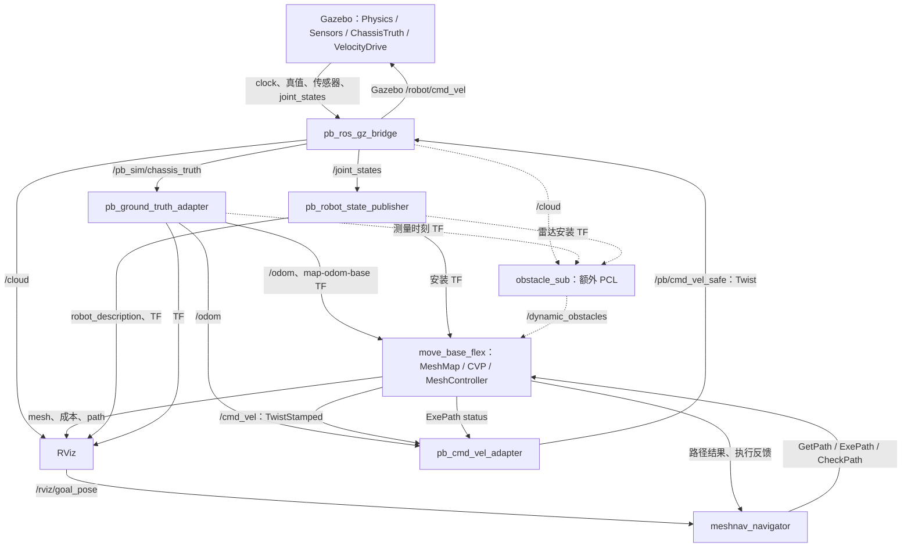

# 当前 PB 仿真：节点、话题、TF 与一次导航的完整时序

核对日期：2026-10-11。本文展开以下入口及当前配置：

```bash
ros2 launch pb_vehicle_adapter meshnav_pb_sim.launch.py
```

当前选择 `ground_truth` 定位、`obstacle_segmentation=none`、`CVPMeshPlanner + MeshController`、PI 仿真底盘、渲染传感器和驻停控制。本文依据源码和配置梳理完整启动链；没有重新启动 Gazebo 或下发运动目标，也不表示本机此刻正在运行完整链路。设备使用旧 install、不同参数或其他入口时，应以设备上的 ROS 图补充核对。

最先需要确认的事实：**主入口不启动 PCL，默认也不启动 RMCL；有 `/cloud` 不代表已有 `/dynamic_obstacles`。** 动态层的输入仍配置为 `/dynamic_obstacles`，完整点云差分链需要单独启动 PCL。

## 1. 启动动作顺序与实际节点

Launch 按下表声明动作，多个进程异步启动。这里的序号不是“上一个节点就绪后，才允许下一个启动”。没有 OnProcessExit/ready 事件把这些进程串行连接。点击一次导航目标也不会再启动一套节点。

| 声明顺序 | 进程／ROS 节点 | 做什么 | 生命周期 |
|---|---|---|---|
| 1 | 设置 Gazebo 环境变量 | 设置资源路径和插件路径 | 启动动作 |
| 2 | Gazebo server；默认另开 GUI | 加载 `rmuc2026_field.sdf`，启动物理、传感器等系统 | 持续；内部系统不是 ROS 节点 |
| 3 | `/pb_ros_gz_bridge` | Gazebo transport 与 ROS 2 双向转换 | 持续 |
| 4 | `/spawn_pb_navigation_robot` | 请求生成模型，模型名 `robot`；位置 `(-11.9,-4.4,0.25)`，yaw=0 | 一次性，完成后退出；两种模型 spawn 声明互斥 |
| 5 | `/pb_robot_state_publisher` | 读取 URDF，发布固定安装 TF、轮关节 TF、机器人描述 | 持续 |
| 6 | `/pb_ground_truth_adapter` | 将 Gazebo chassis 真值换算为导航 `/odom` 和 TF | 持续 |
| 7 | `/pb_cmd_vel_adapter` | 接收导航速度，处理命令超时、取消状态和驻停，输出仿真底盘命令 | 持续 |
| 8 | 条件 RMCL launch | 当前条件不成立，不启动 | 可选 |
| 9 | `/move_base_flex` | 读取 mesh，初始化成本层、规划器、控制器，提供导航 actions/services | 持续 |
| 10 | `/meshnav_navigator` | 接收目标，规划、执行、检查旧路、取消及重规划 | 持续 |
| 11 | `/rviz2_meshnav` | 显示机器人、点云、mesh 成本和路径；发布 Mesh Goal | 默认持续，可关闭 |
| 12 | `/pb_preflight` | 声明动作后约 2 秒墙钟时间启动，只读检查就绪状态 | 一次性；最多等待 180 秒 |

因此，默认完整入口有 **7 个主要持续 ROS 节点**，加 Gazebo 进程和两个一次性工具节点。TF 库等可能创建辅助节点，CLI/daemon 也可能出现在 ROS 图中，它们不是额外的导航算法节点。

若另外执行下面的命令，增加两个主要节点：

```bash
ros2 launch pcl_obstacle_point_subtraction pcl_obstacle_point_subtraction.launch.py
```

| 额外节点 | 用途 | 当前配置 |
|---|---|---|
| `/cloud_tf_publisher` | 从 `/odom` 复制 TF，或补雷达安装 TF | 两个开关均 false，实际不发布 TF |
| `/obstacle_sub` | 将 `/cloud` 与背景 PCD 做差分 | 发布 `/dynamic_obstacles`，供 MBF 动态层使用 |

`start_sim=False` 时，主入口跳过 Gazebo、桥接、spawn 和三个仿真适配节点，改为给已有 `/pb_cmd_vel_adapter` 设置 `control_source=meshnav`；它依赖另一终端已经启动的仿真。

来源：[PB 总入口](../mesh_navigation_tutorials/src/pb_vehicle_adapter/launch/meshnav_pb_sim.launch.py)、[车辆配置](../mesh_navigation_tutorials/src/pb_vehicle_adapter/config/pb_vehicle_profile.yaml)、[导航配置](../mesh_navigation_tutorials/src/mesh_navigation_tutorials/config/mbf_mesh_nav.yaml)、[PCL 入口](../mesh_navigation_tutorials/src/pcl_obstacle_point_subtraction/launch/pcl_obstacle_point_subtraction.launch.py)。

## 2. 整体数据流

实线是默认主链，虚线表示需额外启动 PCL 的动态障碍支路。图中 actions/services 不等同于普通话题。



`/clock` 经桥接送给所有设置 `use_sim_time=true` 的节点。传感器、真值和关节状态异步输出；跨话题没有保证的到达次序。不同节点拿到 TF 的时间可能晚于拿到点云的时间，因此点云算法按测量 stamp 查询 TF并等待。

## 3. Gazebo 先产生哪些数据，桥接后谁使用

表中的 ROS 消息类型采用完整名称。除了最后一行 ROS→GZ，其余均为 GZ→ROS。Gazebo 端的类型简写属于 `ignition.msgs`。

| Gazebo 发布者／订阅者 | Gazebo 话题 · 类型 | ROS 话题 · 类型 | 当前下游使用者 | 频率／触发 |
|---|---|---|---|---|
| 世界时钟 | `/clock` · Clock | `/clock` · `rosgraph_msgs/msg/Clock` | MBF、navigator、RSP、真值/速度适配器、RViz；PCL 若启动；preflight | 随仿真时间推进 |
| ChassisTruth 系统 | `/pb_sim/chassis_truth` · Odometry | `/pb_sim/chassis_truth` · `nav_msgs/msg/Odometry` | 真值适配器 | 约 100 仿真 Hz |
| VelocityDrive 系统 | `/robot/odometry` · Odometry | `/pb/odom_raw` · `nav_msgs/msg/Odometry` | 当前导航主链无消费者；用于对照记录 | 每个仿真步 |
| chassis IMU | `/robot/imu` · IMU | `/imu/data` · `sensor_msgs/msg/Imu` | 当前真值导航主链无消费者 | 配置 200 仿真 Hz |
| 前 RPLidar | `/robot/scan` · LaserScan | `/scan` · `sensor_msgs/msg/LaserScan` | 当前主链无消费者 | 配置 10 仿真 Hz |
| MID360 模拟激光雷达 | `/robot/cloud/points/points` · PointCloudPacked | `/cloud` · `sensor_msgs/msg/PointCloud2` | RViz；PCL 若启动 | 配置 20 仿真 Hz |
| 相机 | `/robot/camera/image` · Image | `/camera/image_raw` · `sensor_msgs/msg/Image` | 当前主链无消费者 | 配置 30 仿真 Hz |
| 相机 | `/robot/camera/camera_info` · CameraInfo | `/camera/camera_info` · `sensor_msgs/msg/CameraInfo` | 当前主链无消费者 | 相机信息 |
| JointStatePublisher 系统 | `/robot/joint_states` · Model | `/joint_states` · `sensor_msgs/msg/JointState` | RSP | 每个仿真步，实际随引擎推进 |
| PosePublisher 系统 | `/model/robot/pose` · Pose_V | `/pb/poses_raw` · `tf2_msgs/msg/TFMessage` | 当前主链无消费者 | 配置 50 仿真 Hz |
| SceneBroadcaster 系统 | `/world/rmuc2026_field/dynamic_pose/info` · Pose_V | `/pb/world_poses_raw` · `tf2_msgs/msg/TFMessage` | 当前主链无消费者 | 世界系统更新，仓库未指定频率 |
| VelocityDrive 接收命令 | `/robot/cmd_vel` · Twist | `/pb/cmd_vel_safe` · `geometry_msgs/msg/Twist` | ROS 端桥接订阅，Gazebo 端驱动订阅 | 速度适配器 30 墙钟 Hz |

桥接节点就是上述 11 路 ROS 输出的发布者，也是 `/pb/cmd_vel_safe` 的 ROS 订阅者。桥配置未覆盖 QoS，Humble 默认 ROS 两端为 Reliable、Volatile、KeepLast depth 10；设备可能通过 QoS overrides 改变它，应以 `ros2 topic info -v` 为准。[Humble bridge 源码](https://raw.githubusercontent.com/gazebosim/ros_gz/humble/ros_gz_bridge/src/factory.hpp)

模型中的雷达基础 topic 写成 `/robot/cloud/points`，点云输出追加 `/points`，桥接的完整名是 `/robot/cloud/points/points`。相机信息默认以图像 topic 的父路径追加 `/camera_info`，对应本表的配置。[Gazebo CameraSensor 源码](https://raw.githubusercontent.com/gazebosim/gz-sensors/ign-sensors6/src/CameraSensor.cc)

还有一个 MID360 IMU，配置 200Hz、frame `front_mid360`，没有显式 topic，当前桥配置没有它。接触诊断系统默认关闭，没有对应活动诊断支路。关闭 `spawn_rendering_sensors` 会移除两台 GPU 雷达和相机，桥节点仍在，但这些输入不会产生数据。

世界步长是 0.001 秒，目标实时因子 1.0。表中的“仿真 Hz”是模型目标频率，机器人 PC 跑慢后每秒墙钟收到的消息可能更少。

来源：[完整桥配置](../mesh_navigation_tutorials/src/pb_vehicle_adapter/config/pb_ros_gz_bridge.yaml)、[模型 SDF](../mesh_navigation_tutorials/src/pb_vehicle_adapter/models/pb_navigation_robot.sdf)、[模型运行时转换](../mesh_navigation_tutorials/src/pb_vehicle_adapter/pb_vehicle_adapter/robot_model.py)、[世界](../mesh_navigation_tutorials/src/mesh_navigation_tutorials_sim/worlds/rmuc2026_field.sdf)。

## 4. 真值先转换为导航位姿、速度和 TF

| 接口 | 发布者 | 订阅者／使用者 | 关键数据 |
|---|---|---|---|
| `/pb_sim/chassis_truth` · Odometry | bridge，源为 Gazebo ChassisTruth | 真值适配器 | world=`rmuc2026_field`、child=`chassis`；物理引擎位姿、chassis 系速度、该步仿真 stamp |
| `/odom` · Odometry | `/pb_ground_truth_adapter` | MBF、速度适配器；额外 PCL 的 cloud_tf_publisher | header=`odom`、child=`base_footprint`；真值换算后的 pose/twist，保留采样 stamp |
| `/tf_static` · TFMessage | 真值适配器 | MBF、RViz、preflight；PCL 若启动 | 恒等 `map→odom`，初始化发布 |
| `/tf` · TFMessage | 真值适配器 | 同上 | 每个有效真值发布 `odom→base_footprint` |
| `/pb/truth_health` · Bool | 真值适配器 | 当前默认导航链没有订阅者 | 有效真值健康状态；正常约 10 墙钟 Hz 的 True，False 在首次／状态变化时发 |

适配器使用 `base_footprint→chassis=[0,0,0.076]` 换算参考点，并处理旋转引起的杠杆臂速度。**保留 z、roll、pitch、yaw，`base_footprint` 在这里没有被压成二维。** 回调代码依次发布动态 TF、里程计、更新健康状态；DDS 不保证跨话题同序到达。

零时间戳或位置/twist的非有限数值被拒绝；重复 stamp 不刷新有效接收时间。当前代码尚无完整的输入四元数和frame校验，零四元数会退化成单位四元数。超过 0.5 秒墙钟没有有效真值，健康转为 false，不持续发布冻结里程计。速度适配器用自己的 `/odom` 新鲜度判断，默认不订阅 health Bool。

`/pb/odom_raw`、`/pb/poses_raw`、`/pb/world_poses_raw` 都没有进入这条换算链。后两者虽是 TFMessage 类型，**它们不是 `/tf`，不会自动加入导航 TF 树**。桥配置中关于“拼接 raw poses”的旧注释不代表当前实现。

来源：[真值适配器](../mesh_navigation_tutorials/src/pb_vehicle_adapter/pb_vehicle_adapter/ground_truth_adapter.py)、[ChassisTruth](../mesh_navigation_tutorials/src/pb_gazebo_sim_support/src/chassis_truth_system.cc)。

## 5. 完整 TF 树、发布者与消费者

箭头表示父 frame 到子 frame 的变换，平移数值在父系中，单位米。

```text
map
└── odom                           真值适配器，/tf_static，恒等
    └── base_footprint              真值适配器，/tf，约100仿真Hz，完整6DoF
        └── chassis                RSP，/tf_static，[0,0,0.076]
            ├── front_mid360       RSP，/tf_static，[0.10,0,0.11]
            ├── front_rplidar_a2   RSP，/tf_static，[-0.10,0,0.11]
            ├── front_industrial_camera
            │                      RSP，/tf_static，[0.16,0,0.065]
            │   └── front_industrial_camera_optical_frame
            │                      RSP，/tf_static，rpy=[-π/2,0,-π/2]
            ├── front_left_wheel   RSP，/tf，由对应关节状态更新
            ├── front_right_wheel  RSP，/tf，由对应关节状态更新
            ├── rear_left_wheel    RSP，/tf，由对应关节状态更新
            └── rear_right_wheel   RSP，/tf，由对应关节状态更新
```

URDF 没有 `base_link`。Gazebo 世界名 `rmuc2026_field` 是真值消息的 frame 名；当前适配器假定世界、地图、odom 数值已对齐，不另发布 `rmuc2026_field→map`。

RSP 的 `publish_frequency=100` 是关节回调驱动动态 TF 的上限，固定 TF 初始化发布到 `/tf_static`；它不是独立 100Hz 轮子 TF 定时器。RSP 订阅 `/joint_states`，发布 `/meshnav/robot_description` String（Reliable、TransientLocal、depth1），供 RViz RobotModel 读取。[Humble RSP 源码](https://raw.githubusercontent.com/ros/robot_state_publisher/humble/src/robot_state_publisher.cpp)

| 使用方 | 取哪条变换 | 时间／目的 |
|---|---|---|
| MBF RobotInformation | `map←odom←base_footprint` | 最新 TF；求当前全局车位，供规划起点和每个控制周期 |
| CVP | 起点/目标 frame→map | PoseStamped 的 stamp；输入已是 map 时无需变换 |
| MBF CheckPath | 各路径 pose frame→map | pose stamp；路径 frame 提供默认值 |
| TemporalObstacleLayer | `map←cloud_frame`、`cloud_frame←front_mid360`、`map←odom`、`map←axis_frame` | 同一障碍观测 stamp；障碍投影、测量原点、定位跳变检查和向下投影方向 |
| PCL obstacle_sub，若启动 | `base_footprint←odom`、`front_mid360←base_footprint` | 输入 cloud stamp；组合求 odom←雷达，做背景差分，再回 base 系 |
| RViz | map←各显示 frame；base_footprint 位姿 | 点云、mesh、机器人、TF 显示及视角跟随 |
| pb_preflight | map←base_footprint | 最新 TF；就绪检查 |

MeshController 接收 MBF 已求得的 map 车位，不单独维护另一套 TF 查询。navigator 的当前位姿来自 ExePath feedback，没有 `/odom` 或 TF 订阅。truth adapter、cmd adapter 和 bridge 都不通过 TF 查询计算业务数据。

MID360 的 link 原点在 base 系为 `[0.10,0,0.186]`，仿真测量原点额外局部 z `+0.03`，即高度 0.216。PCL 和 Temporal 各自按参数/算法补偿；这是内部计算，不是 TF 树新增一条边。不要打开 cloud_tf_publisher 另外广播同名雷达 TF，产生重复发布和偏移重复计算。

来源：[URDF](../mesh_navigation_tutorials/src/pb_vehicle_adapter/urdf/pb_navigation_robot.urdf)、[MBF 位姿查询](../mesh_navigation_tutorials/src/move_base_flex/mbf_utility/src/robot_information.cpp)、[Temporal 层](../mesh_navigation_tutorials/src/mesh_navigation/mesh_layers/src/temporal_obstacle_layer.cpp)。

## 6. 地图与障碍在 /move_base_flex 内怎样流转

`MeshMap`、`LayerManager`、`CVPMeshPlanner`、`MeshController` 都在 **同一个 `/move_base_flex` 节点进程里**，不是四个 ROS 节点。启动时读取 PLY / HDF5 工作缓存，初始化成本层和共享地图，然后对外提供 action/service。

```text
mesh PLY／HDF5 → 三角面、顶点、法向、邻接关系
                    │
     border + height_diff + roughness
                    ↓ 加权合成，权重分别1、1、0.3
           static_combination
                    ↓
           static_inflation ───────────┐
                                      ↓
/dynamic_obstacles → obstacle → obstacle_inflation → final=max(静态,动态)
                                      │
                         顶点成本、致命点集合、边权
                                      ↓
                     CVP规划 / CheckPath检查
```

实际层初始化顺序：`border → height_diff → roughness → static_combination → static_inflation → obstacle → obstacle_inflation → final`。层间通过进程内对象和 onInputChanged 回调传播；`/vertex_costs` 是对外显示输出。

当前地图源为 `mesh_navigation_tutorials/src/mesh_navigation_tutorials/maps/rmuc2026_field.ply`；工作缓存为 `mesh_navigation_tutorials/rmuc2026_field.h5`。YAML 使用本机绝对路径；PLY、Gazebo 场地及差分 PCD 必须对齐。

| 参数／处理 | 当前实际值与含义 |
|---|---|
| 规划默认层 | `final` |
| 静态膨胀 | 硬圈 0.15m，外圈 1.0m，内圈成本 1.0 |
| 动态膨胀 | 硬圈 0.30m，外圈 0.60m，内圈成本 0.99 |
| planner / CheckPath | 成本 `>=0.99` 即不可通行；等于0.99也被拒绝 |
| 边权 | 边长 + `5.0 × 边上成本积分` |
| Temporal 输入 | PointCloud2；当前 Reliable、Volatile、depth1 |
| 观测新鲜度 | 最大0.30s；零/重复/乱序/超龄帧及 TF 失败不修改历史 |
| 障碍投影 | map 系向下 `[0,0,-1]`；robot_height=0.50m；最远8m |
| 历史 | 0.05m体素、STVL线性保留10s、加速系数0 |

历史过期由**新的有效观测**推进，没有独立 decay timer；有效空点云也能推进过期，断流保持已有障碍成本。动态成本变化不会直接通知 navigator 立即重规划，也不会直接改写控制器先前复制的向量场；navigator 的 2Hz 路径检查负责发现堵路。该检查按ROS仿真时间调度，仿真变慢或暂停时，不保证每0.5秒墙钟进行一次。

当前 MeshController 的 `naiveControl` 没有使用传入的 mesh_cost 做动态停障判断。配置里的 `arrival_fading` 也没有实际参与速度计算。不要把这些 YAML 注释当作已实现的运行行为。

来源：[MeshMap](../mesh_navigation_tutorials/src/mesh_navigation/mesh_map/src/mesh_map.cpp)、[层管理](../mesh_navigation_tutorials/src/mesh_navigation/mesh_map/src/layer_manager.cpp)、[控制器](../mesh_navigation_tutorials/src/mesh_navigation/mesh_controller/src/mesh_controller.cpp)、[导航配置](../mesh_navigation_tutorials/src/mesh_navigation_tutorials/config/mbf_mesh_nav.yaml)。

## 7. 可选 PCL 的每帧处理顺序

此节只有单独启动 PCL 时成立，默认总入口没有这条生产链。

1. `/obstacle_sub` 启动时读取背景 PCD：当前配置路径 `/home/rainple/nav_test/field/pcd/rmuc2026_field.pcd`，构建背景 KD 树。
2. 订阅 `/cloud`，PointCloud2，Reliable/Volatile/depth1；XYZ 属于 `front_mid360`，使用输入采样 stamp。
3. 查询该 stamp 的 `base_footprint←odom` 和 `front_mid360←base_footprint`，每次最多等待0.05s。
4. 组合为 `odom←front_mid360`，合入仿真雷达局部 z +0.03m，将输入点变换到 odom。
5. 与背景做最近邻差分：距离背景最近点大于0.08m的点保留。
6. 差异点变换回 base_footprint，再去掉 XY 距离<0.4m的车体附近点。
7. 发布 `/dynamic_obstacles` PointCloud2，frame=`base_footprint`、原始输入 stamp，Reliable/Volatile/depth1。
8. MBF 内 TemporalObstacleLayer 收到这帧，按该 stamp 取 TF、验证年龄、投影到 mesh、更新历史及动态成本。

输出由输入回调驱动，处理不及时或 TF失败会降低有效输出频率，不是独立20Hz定时器。cloud_tf_publisher 默认虽然订阅 `/odom`，但两种广播开关都 false，无业务输出。

当前源目录的 PCL 与 `doc/sim2real_templates/patches/pcl_real_interfaces.patch` 是两件事：文档补丁不会自动生效。原始实现遇到背景文件读取失败会记录错误并可能把全输入当成差异；不能只凭它在发布就认为背景差分成功。本机背景PCD当前仍存在；部署到另一台电脑时要核对绝对路径及地图对齐。

来源：[PCL 源码](../mesh_navigation_tutorials/src/pcl_obstacle_point_subtraction/src/pcl_obstacle_point_subtraction.cpp)、[PCL 参数](../mesh_navigation_tutorials/src/pcl_obstacle_point_subtraction/config/pcl_obstacle_point_subtraction.yaml)。

## 8. 点击目标后，一次导航按什么顺序发生

下面是业务因果顺序；传感器、TF、时钟、显示和控制反馈在全过程持续并行。

| 步骤 | 谁做什么 | 输入 → 输出 | 下一步谁用 |
|---|---|---|---|
| 1 | RViz Mesh Goal 点击/拖动目标 | 用户交互 → `/rviz/goal_pose` PoseStamped，map系、now stamp、目标位置和朝向 | navigator |
| 2 | navigator 验证并接纳新目标 | frame、有限值、四元数校验；有旧任务则先取消并等退出 | navigator 进入 planning |
| 3 | navigator 请求 GetPath | `use_start_pose=false`，`target_pose`，`planner=mesh_planner` | MBF GetPath action |
| 4 | MBF 求车辆起点 | 最新 `map←odom←base_footprint` TF | CVP |
| 5 | CVP 规划 | 起终点、mesh、final顶点成本/边权 → Path、共享向量场、outcome/cost | action结果给 navigator；显示输出给RViz |
| 6 | navigator 检查规划结果 | action SUCCEEDED且outcome=0且路径非空 → ExePath(path,controller=mesh_controller) | MBF 执行 |
| 7 | MeshController 接受路线 | setPlan复制共享CVP向量场，保存终点位置/方向 | 20Hz控制线程 |
| 8 | MBF 每个控制周期 | TF给全局位姿、`/odom`给速度 → 车体系 vx/vy/wz → `/cmd_vel` TwistStamped | cmd adapter |
| 9 | cmd adapter 输出 | 新鲜导航命令 + `/odom` + ExePath状态 → `/pb/cmd_vel_safe` Twist，30墙钟Hz | bridge |
| 10 | bridge 转成 Gazebo 命令 | ROS Twist → Gazebo `/robot/cmd_vel` Twist | VelocityDrive |
| 11 | 仿真驱动物理底盘 | PreUpdate速度误差→有界PI→body/world wrench；Physics推进 | chassis实体状态更新 |
| 12 | Gazebo 反馈运动结果 | ChassisTruth约100仿真Hz→bridge→truth adapter→`/odom`、TF | 回到步骤8；同时供RViz、PCL |
| 13 | MBF 回传执行反馈 | ExePath feedback：current_pose/dist_to_goal/angle_to_goal/last_cmd_vel | navigator保存车位、进度和反馈新鲜度 |
| 14 | navigator 检查剩余路 | 每0.5s ROS仿真时间，根据feedback裁剪路径，调用CheckPath | FREE继续执行；堵路进入下面的重规划过程 |
| 15 | MBF 判定到达 | 距离容差0.2m、角度容差6.3rad → 零 `/cmd_vel` + ExePath success | navigator发succeeded；底盘转驻停分支 |

GetPath action 返回的 Path 被 navigator **直接装进 ExePath goal**。`/move_base_flex/path` 是规划器对外发布的显示话题，navigator 和 MeshController 不订阅它。向量场也通过共享地图对象传给控制器，不靠订阅 `/vector_field`。

角度容差6.3rad约等于一整圈，因此当前导航基本不强制终点朝向对齐。MeshController 当前平面合速度上限0.8m/s、角速度上限0.5rad/s，holonomic=true，允许 vy。

VelocityDrive 对 chassis 施加力/力矩，不给四个轮关节下目标，也不靠对 `/odom` 积分来移动模型。`/joint_states` 是仿真关节状态，不能当成实车编码器或底盘通讯协议。

来源：[协调节点](../mesh_navigation_tutorials/src/pb_vehicle_adapter/pb_vehicle_adapter/meshnav_navigator.py)、[CVP](../mesh_navigation_tutorials/src/mesh_navigation/cvp_mesh_planner/src/cvp_mesh_planner.cpp)、[MBF 控制执行](../mesh_navigation_tutorials/src/move_base_flex/mbf_abstract_nav/src/abstract_controller_execution.cpp)、[PI 底盘](../mesh_navigation_tutorials/src/pb_gazebo_sim_support/src/velocity_drive_system.cc)。

## 9. 动态障碍、取消、到达后的分支时序

动态堵路重规划：

```text
新 /cloud → PCL → /dynamic_obstacles
→ Temporal更新 obstacle → obstacle_inflation → final
→ navigator下一次CheckPath，约2Hz，按ROS仿真时间
→ LETHAL或OUTSIDE
→ navigator状态replanning，发送旧ExePath cancel
→ MeshController下一控制周期响应取消，MBF发零速度
→ cmd adapter收到Cancel状态后清命令/驻停，抑制旧任务动作
→ 等旧ExePath确认结束
→ 从当前TF车位重新GetPath
→ 成功：新的ExePath，被Accepted/Executing后解除速度抑制
→ 暂时NO_PATH/BLOCKED_START/BLOCKED_GOAL：停车，每0.5s重试，最多15墙钟秒
```

FREE 时维持原路径，并非每0.5s重新规划。UNKNOWN、请求失败、反馈超过2墙钟秒未刷新或请求超过15墙钟秒等情况会失败并请求停止。动态层有输入但旧路线仍可通行时，只改变成本显示，不触发换路。navigator 的tick为20Hz稳态timer，路径检查间隔用ROS时间；请求/反馈超时和重规划等待总时限用墙钟。

即使CheckPath持续FREE，控制器本身也可能失败：车辆连续忽略非零速度指令超过当前10秒容差，MBF以ROBOT_STUCK终止ExePath；失去mesh表面、缺少向量场或控制计算失败，会进入配置的重试/超时逻辑，发零并终止。navigator收到执行失败结果后发布failed。停车原因不只包括障碍、取消和通信超时。

主动取消：外部调用 `/meshnav_navigator/cancel` Trigger → navigator取消GetPath/ExePath → 等执行结束 → status=`canceled`。Trigger成功只表示受理请求，不代表执行已结束或物理速度已经零。

到达：MBF发零速度 → ExePath `SUCCEEDED` → navigator `succeeded`。当前 `hold_enabled=true`，SUCCEEDED不会抑制驻停；导航命令停更0.5墙钟秒且odom仍新鲜后，cmd adapter可能发小幅非零校正速度保持位置。vx、vy分别限幅±0.1m/s，wz限幅±0.2rad/s。**成功后 `/pb/cmd_vel_safe` 不一定永远为零。**

速度/里程计断流：cmd adapter按0.5s墙钟判断命令接收超时、按±0.5s ROS时间检查命令stamp；位姿失效或超过0.3s清命令并发零。VelocityDrive另有0.5s墙钟命令超时，将目标速度设零。正常命令转发没有独立速度/加速度限幅，也没有实车 enable/急停接口；这是当前仿真适配行为。

来源：[速度适配器](../mesh_navigation_tutorials/src/pb_vehicle_adapter/pb_vehicle_adapter/cmd_vel_adapter.py)、[协调节点](../mesh_navigation_tutorials/src/pb_vehicle_adapter/pb_vehicle_adapter/meshnav_navigator.py)。

## 10. 导航与显示话题完整补充表

以下补齐桥接表之外的普通业务话题。R=Reliable，BE=BestEffort，V=Volatile，TL=TransientLocal。depth为KeepLast条数；频率表示目标或事件触发行为。

| 话题 · 类型 | 发布者 | 默认订阅者／使用者 | QoS与实际触发 |
|---|---|---|---|
| `/rviz/goal_pose` · `geometry_msgs/msg/PoseStamped` | RViz MeshGoal工具 | navigator | R/V/1；用户发目标时 |
| `/initialpose` · `geometry_msgs/msg/PoseWithCovarianceStamped` | RViz SetInitialPose工具 | 默认真值链无人处理 | R/V/5；用户点击该工具时，非导航目标 |
| `/odom` · `nav_msgs/msg/Odometry` | truth adapter | MBF、cmd adapter；cloud_tf_publisher若启动 | 发布R/V/20；有效真值驱动，约100仿真Hz；MBF订阅depth1 |
| `/cmd_vel` · `geometry_msgs/msg/TwistStamped` | MBF | cmd adapter | 发布R/V/1；执行约20Hz，取消/到达另发零；header.base_footprint |
| `/pb/cmd_vel_safe` · `geometry_msgs/msg/Twist` | cmd adapter | bridge | R/V/10；30墙钟Hz，无header |
| `/pb/jie_cmd_vel_stamped` · TwistStamped | 当前无发布者 | cmd adapter备用输入 | 订阅R/V/20；当前control_source不选它 |
| `/pb/dddmr_cmd_vel_stamped` · TwistStamped | 当前无发布者 | cmd adapter备用输入 | 同上；不表示运行JIE/DDDMR节点 |
| `/pb/truth_health` · `std_msgs/msg/Bool` | truth adapter | 当前默认无订阅者 | R/V/10；健康时10Hz，False状态变化发 |
| `/dynamic_obstacles` · `sensor_msgs/msg/PointCloud2` | 额外PCL obstacle_sub | MBF Temporal层 | R/V/1；输入有效cloud驱动，base_footprint和原stamp |
| `/meshnav/robot_description` · `std_msgs/msg/String` | RSP | RViz RobotModel | R/TL/1；初始化/描述更新 |
| `/move_base_flex/current_goal` · `geometry_msgs/msg/PoseStamped` | MBF | 当前RViz无对应启用显示 | R/V/1；规划开始、执行接纳路径时 |
| `/move_base_flex/path` · `nav_msgs/msg/Path` | CVP，位于MBF进程 | RViz Path | R/TL/1；每次规划；map系，不是速度控制输入topic |
| `/move_base_flex/mesh` · `mesh_msgs/msg/MeshGeometryStamped` | MeshMap，位于MBF进程 | RViz MeshMap | R/TL/1；地图加载；header/uuid/顶点/法向/三角面 |
| `/move_base_flex/vertex_colors` · `mesh_msgs/msg/MeshVertexColorsStamped` | MeshMap | 当前Vertex Costs显示模式不订阅 | R/TL/1；地图含颜色属性时 |
| `/move_base_flex/vertex_costs` · `mesh_msgs/msg/MeshVertexCostsStamped` | LayerManager、CVP | RViz MeshMap | R/TL/8；层初始化、新订阅者增加时重发；CVP另发Potential |
| `/move_base_flex/vertex_costs/updates` · `mesh_msgs/msg/MeshVertexCostsSparseStamped` | LayerManager | RViz MeshMap | R/TL/10；层变化；顶点索引、成本、default_value、type层名、uuid |
| `/move_base_flex/vector_field` · `visualization_msgs/msg/Marker` | MeshMap / CVP | 当前RViz无对应启用显示 | R/TL/1；publish_vector_field=true，规划事件 |
| `/move_base_flex/marker` · `visualization_msgs/msg/Marker` | MeshMap | 当前RViz无对应启用显示 | R/V/100；调试事件，不保证持续输出 |
| `/move_base_flex/edge_weights` · `visualization_msgs/msg/MarkerArray` | MeshMap | 当前RViz无对应启用显示 | R/TL/1；配置关闭文本输出，publisher存在但通常无数据 |
| `/move_base_flex/current_angle` · `example_interfaces/msg/Float32` | MeshController | 当前默认无订阅者 | R/TL/1；仅DEBUG_CALL启用时发，单位度 |
| `/meshnav_navigator/status` · `std_msgs/msg/String` | navigator | CLI/外部观察者；当前RViz无该display | R/TL/1；JSON状态变化，含state/plans及事件字段 |
| `/tf` · `tf2_msgs/msg/TFMessage` | truth adapter + RSP | MBF、RViz、preflight；PCL若启动 | 发布R/V/100；动态TF |
| `/tf_static` · `tf2_msgs/msg/TFMessage` | truth adapter + RSP | 同上 | 静态广播TL；late joiner能取到 |

全量vertex_costs消息包含header、uuid、type层名和完整float成本；稀疏消息只带改变顶点。LayerManager每200ms检查新订阅者，**不代表每200ms无条件发布完整地图**。

RViz原始点云订阅BE/V/5，Path订阅R/V/5，mesh订阅R/TL/1，全量成本订阅R/V/20，稀疏成本订阅R/V/10。当前显示层是final；可视化PointCloud2并不是障碍差分点云。发布者TL与订阅者V相容，但只有TL订阅者会请求历史样本；LayerManager的新订阅者重发保证当前成本能刷新。

`/rosout`（`rcl_interfaces/msg/Log`）、`/parameter_events`（`rcl_interfaces/msg/ParameterEvent`）及每节点参数服务属于ROS基础设施。它们用于日志、参数检查/修改，不参与Path→速度→物理运动闭环。是否启用日志、额外辅助节点和订阅者取决于ROS选项。

来源：[RViz配置](../mesh_navigation_tutorials/src/pb_vehicle_adapter/rviz/pb_meshnav.rviz)、[MeshMap话题创建](../mesh_navigation_tutorials/src/mesh_navigation/mesh_map/src/mesh_map.cpp)、[成本发布](../mesh_navigation_tutorials/src/mesh_navigation/mesh_map/src/layer_manager.cpp)、[目标工具](../mesh_navigation_tutorials/src/mesh_tools/rviz_mesh_tools_plugins/src/MeshGoalTool.cpp)。

## 11. Actions、services及隐藏话题

| 接口 | 类型 | 客户端 → 服务端 | 当前用途 |
|---|---|---|---|
| `/move_base_flex/get_path` | `mbf_msgs/action/GetPath` | navigator → MBF | 规划：目标/起点选项 → outcome/message/Path/cost；反馈结构为空 |
| `/move_base_flex/exe_path` | `mbf_msgs/action/ExePath` | navigator → MBF | 执行：Path/controller → current_pose、dist、angle、last_cmd_vel反馈及最终result |
| `/move_base_flex/check_path_cost` | `mbf_msgs/srv/CheckPath` | navigator → MBF | 约2Hz ROS仿真时间检查剩余Path的final成本，返回state/cost/last_checked |
| `/meshnav_navigator/cancel` | `std_srvs/srv/Trigger` | CLI/外部程序 → navigator | 接纳取消请求，等待状态结束 |
| `/move_base_flex/move_base` | `mbf_msgs/action/MoveBase` | 当前PB流程不调用 | MBF原生复合入口，不要混入PB coordinator时序 |
| `/move_base_flex/refine_path` | `mbf_msgs/action/RefinePath` | 当前PB流程不调用 | server存在，当前无refiner插件 |
| `/move_base_flex/recovery` | `mbf_msgs/action/Recovery` | 当前PB流程不调用 | server存在，当前无recovery插件 |
| `/move_base_flex/check_pose_cost` | `mbf_msgs/srv/CheckPose` | 当前PB流程不调用 | 函数体TODO，不能视为已实现车体碰撞检测 |
| `/move_base_flex/clear_mesh` | `std_srvs/srv/Empty` | 外部工具 → MBF | resetLayers仍为TODO/return true，当前不会实际清历史 |
| `/move_base_flex/save_map` | `std_srvs/srv/Trigger` | 外部工具 → MeshMap | 保存工作HDF5成本层 |
| `/pb_cmd_vel_adapter/get_parameters` | `rcl_interfaces/srv/GetParameters` | preflight → cmd adapter | 确认control_source=meshnav |

每个action名 `A` 下还有以下ROS实体：

| 名称 | ROS实体／类型 | 方向 |
|---|---|---|
| `A/_action/send_goal` | service；`<Action>_SendGoal` | client请求goal；server返回accepted和stamp |
| `A/_action/get_result` | service；`<Action>_GetResult` | client等待result；server返回状态和业务结果 |
| `A/_action/cancel_goal` | service；`action_msgs/srv/CancelGoal` | client取消；server返回受理信息 |
| `A/_action/feedback` | topic；`<Action>_FeedbackMessage` | server→client，含goal_id及feedback |
| `A/_action/status` | topic；`action_msgs/msg/GoalStatusArray` | server→action clients；ExePath这路另被cmd adapter订阅 |

例如执行反馈完整名 `/move_base_flex/exe_path/_action/feedback`，类型 `mbf_msgs/action/ExePath_FeedbackMessage`；控制正常时约20Hz。执行状态完整名 `/move_base_flex/exe_path/_action/status`。默认action services及feedback R/V/10，status R/TL/1。

CheckPath在本实现中只支持非空Path、GLOBAL_COSTMAP、path_cells_only=true、skip_poses=0；以0.025m间隔检查线段，投影距mesh>0.4m判OUTSIDE，成本>=0.99判LETHAL，无成本/无效值/TF失败判UNKNOWN，完成判FREE。它不做完整footprint查询，余量来自膨胀层。

preflight不发布目标、速度或TF，不检查cloud/dynamic_obstacles，也不控制运动许可；它在启动后旁路检查时钟推进、车位TF、发布者、MBF及GetPath/ExePath存在，然后退出。

来源：[MBF动作与服务创建](../mesh_navigation_tutorials/src/move_base_flex/mbf_abstract_nav/src/abstract_navigation_server.cpp)、[mesh服务实现](../mesh_navigation_tutorials/src/mesh_navigation/mbf_mesh_nav/src/mesh_navigation_server.cpp)、[action消息定义](../mesh_navigation_tutorials/src/move_base_flex/mbf_msgs/action/ExePath.action)、[preflight](../mesh_navigation_tutorials/src/pb_vehicle_adapter/pb_vehicle_adapter/pb_preflight.py)。

## 12. 可选分支与现场只读核对

RMCL、MPPI、FAST-LIVO2、JIE、DDDMR、PbTerminalController、地图测试source_cloud/plan_only，都不在当前默认主链。包安装成功、备用参数存在或者有备用订阅，均不代表节点在运行。

条件RMCL只有渲染传感器开启，且localization=rmcl_micpl或obstacle_segmentation=rmcl_seg时才被主入口包含。当前源码里的RMCL目录已删除；以下仅列保留launch和历史实现的接口，不能当作当前可运行承诺：

| 可选节点 | 输入 | 输出／TF | 接线注意 |
|---|---|---|---|
| `rmcl_lidar3d_conversion` | `/cloud` PointCloud2 | `/rmcl_inputs/cloud` `rmcl_msgs/msg/O1DnStamped`；可选debug_cloud | 保留输入stamp/雷达frame |
| `rmcl_micpl` | O1Dn、`/initialpose`、TF、mesh | `map→odom` TF、micpl_stats及调试；micpl_pose publisher存在但历史发布调用被注释 | 真值适配器也发布map→odom，启用时须明确唯一所有者 |
| `rmcl_seg` | O1Dn、测量stamp的map←sensor TF | `/obstacle_points`及`/rmcl_seg/outlier_map` PointCloud2 | 当前没有自动remap到动态层所需的`/dynamic_obstacles` |

入口区别：根目录 `launch/meshnav_map_test.launch.py` 仅做wall-time静态地图显示，可能有 `/meshnav_source_cloud` 发布 `/meshnav/source_cloud`；它不启动PB底盘、真值TF或navigator。通用 `mbf_mesh_navigation_server_launch.py` 只启动MBF。不能把这些入口的节点混入本页PB仿真图。

在实际仿真电脑执行以下只读命令，可核对安装版本的实际图；不会发送运动命令：

```bash
ros2 node list
ros2 node info /move_base_flex
ros2 node info /meshnav_navigator
ros2 node info /pb_cmd_vel_adapter
ros2 topic list -t --include-hidden-topics
ros2 topic info /dynamic_obstacles -v
ros2 topic info /cmd_vel -v
ros2 topic info /cloud -v
ros2 action list -t
ros2 service list -t
ros2 run tf2_ros tf2_echo map base_footprint
ros2 run tf2_ros tf2_echo base_footprint front_mid360
ros2 topic echo /meshnav_navigator/status --once --qos-durability transient_local
```

`tf2_echo`持续运行，用Ctrl-C退出。若某设备ROS CLI不支持某个选项，用该命令的`--help`核对。检查话题不能只看名字，必须看publisher数量、类型、QoS、frame和stamp；话题可能只有订阅者。

本次只做源码/配置审计和文档整理。地图、模型和插件配置含本机绝对路径，移到另一台电脑需核对；这张图表示当前入口设计的完整链路，不代表当前工作区已经通过完整启动验收。
