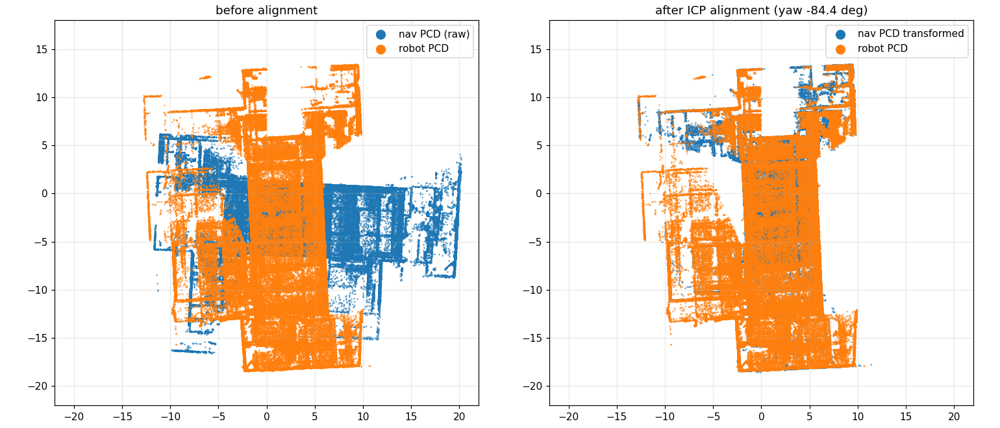
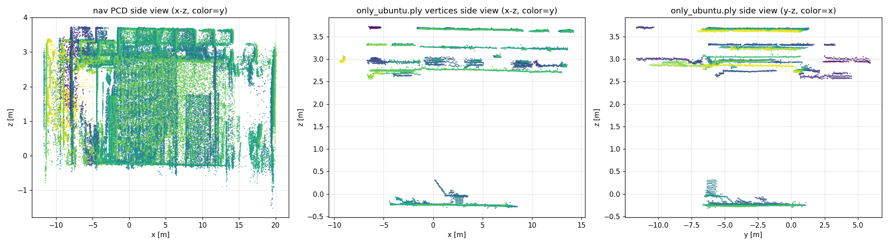
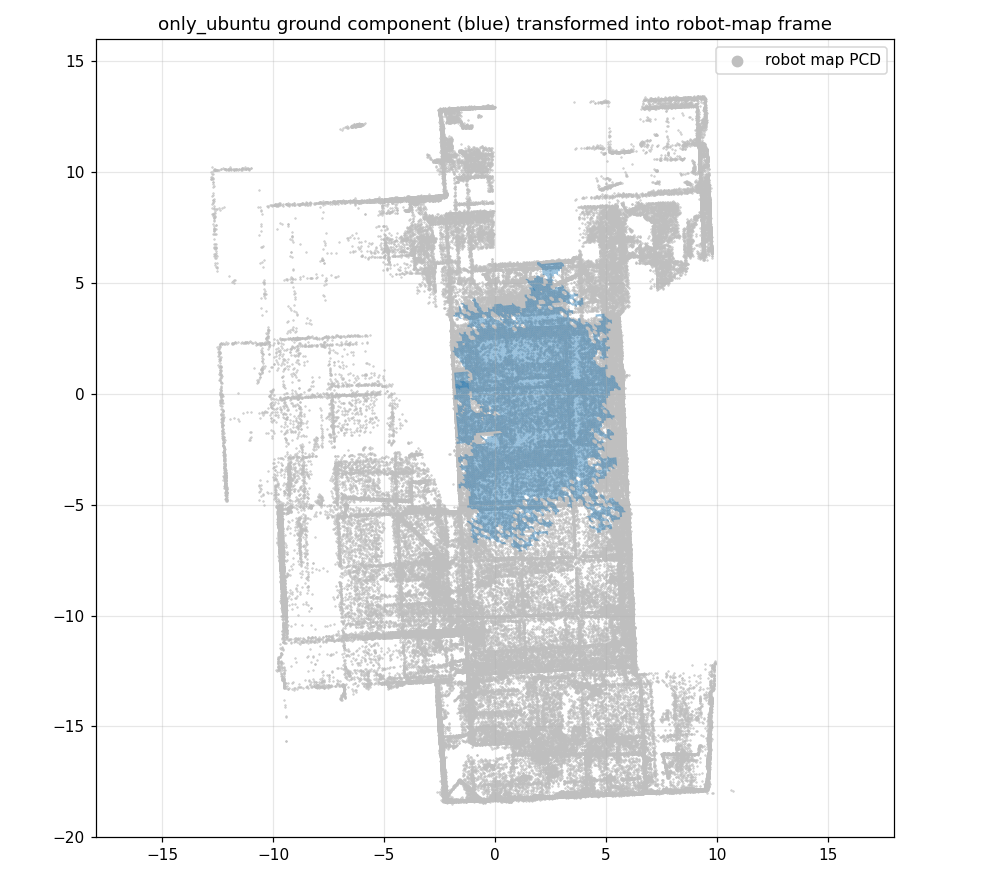

# 读完了：`test.sh` 实际链路 + 三个会让 MeshNav 跑不起来的问题

## 1. `test.sh` 到底启动了哪些节点

[test.sh](/home/rm/26_Sentry/test.sh) 按顺序启动 6 组节点（每组一个 `gnome-terminal`，间隔 4 s）：

| 顺序 | 命令 | 主要输出 |
|---|---|---|
| 1 | `livox_ros_driver2 msg_MID360_launch.py` | `/livox/lidar`（CustomMsg）、`/livox/imu` |
| 2 | `fast_livo mapping_mid360.launch.py` | `/cloud_registered`、`/Odometry`、`/path`，TF `camera_init→aft_mapped` |
| 3 | `registration registration.launch.py` | 加载 `map_down.pcd`，发布 `map→odom`（约 59 Hz）、`/registration_status`、`/relocalization/state_for_tf` |
| 4 | `hnurm_uart hnurm_uart.launch.py` | 订阅 `/cmd_vel`（**Twist**），串口发 `vel_x/vel_y/vel_z` |
| 5 | `hnurm_bringup tf_transformer.launch.py` | `/Odometry` → `/Odometry_transformed`，TF `odom→base_link`、静态 `base_link→base_footprint→lidar_link→livox_frame`、`odom→camera_init` |
| 6 | `hnurm_bringup test.launch.py` | linefit 地面分割 + pointcloud_filter + pointcloud_to_laserscan → `/pointcloud`、`/scan` |

它**不启动** MeshNav、Nav2、RViz、视觉/决策。所以你的用法是：先 `test.sh` 起传感器、LIO、重定位、TF 和点云，再另开终端起 `nav_test_fix`。

关键事实（源码确认）：

- FAST-LIVO2 的 `/cloud_registered`：`camera_init` 系、**当前帧**（`dense_map_en: true` → `feats_undistort`）、`stamp = now()`。
- `/Odometry`：`camera_init → aft_mapped`，10 Hz。
- FAST-LIVO2 的发布顺序是 **先 `publish_odometry()`，后 `publish_frame_world()`**（[LIVMapper.cpp](/home/rm/26_Sentry/src/hnurm_fastlivo2/FAST-LIVO2/src/LIVMapper.cpp) 第 498/534 行）。这直接导致了下面的 PCL 问题。
- registration 的 `map→odom` 由 17 ms 定时器持续发布，**INIT 阶段也发**（identity），GICP 收敛后才跳到正确值。它加载的是 `map_down.pcd`（42,838 点），不是 `map.pcd`（`generate_downsampled_pcd: false`）。
- tf_transformer 的静态 TF 正常，包括 `odom→camera_init`；`map→odom` 只在收到视觉/自车颜色时由它发布，`test.sh` 里通常只有 registration 在发。

---

## 2. 实际运行日志：PCL 一帧都没成功

13:38 你启动 `pcl_obstacle_point_subtraction` 的日志（`~/.ros/log/pcl_obstacle_point_subtraction_129671_...log`）：

```text
[INFO] Loaded background point cloud with 471809 points.
[WARN] 未查找到TF信息camera_init -> map
[WARN] 未查找到TF信息camera_init -> map
... 每 100 ms 一条，持续到 Ctrl-C
```

`/dynamic_obstacles` 完全没有发布。

### 根因：PCL 用“点云时间戳”查 TF，但动态 TF 比它旧

[PCL 源码](../../mesh_nav_ws/src/pcl_obstacle_point_subtraction/src/pcl_obstacle_point_subtraction.cpp) 里两次查询都用了点云 stamp：

```cpp
lookupTransform(map_frame_, odom_frame_, msg->header.stamp, 0.05s);   // map <- camera_init
lookupTransform(base_frame_, map_frame_, msg->header.stamp, 0.05s);   // base_footprint <- map
```

而 `base_footprint <- map` 这条链包含 **`odom→base_link`**，它由 tf_transformer 用 `/Odometry.header.stamp` 发布，10 Hz。FAST-LIVO2 先发 odom、后发 cloud，cloud 的 stamp 比 odom 新几毫秒到几十毫秒；tf2 不能外推，只能等下一帧 odom，而下一帧在 100 ms 后，50 ms 超时必然失败。**每一帧都失败**，与日志完全一致。

两条查询的 catch 用了同一句日志，所以看起来像 `map<-camera_init` 失败；实际是第二条 `base_footprint<-map` 失败。

### 已验证的修复方向

我在隔离域里用合成 `/Odometry` + `/cloud_registered` 复现：

- cloud stamp = `now` → PCL 一直 TF 失败；
- cloud stamp = `now - 0.06 s`（比最新 odom 旧）→ **立即发布 `/dynamic_obstacles`，3 个点**。

所以改法很明确：

1. 两次 `lookupTransform` 改用**最新可用变换** `rclcpp::Time(0)`（或 `tf2::TimePointZero`），不要再绑定 cloud stamp；
2. 或把超时从 0.05 s 提到 0.2 s 以上（不推荐，会引入延迟）；
3. 同时把两个 catch 的日志分开，分别写 `map<-camera_init`、`base_footprint<-map`，否则下次还会误判。

对 10 Hz 的障碍链路，使用最新 base 位姿（最多旧 100 ms）完全可以接受，比整条链路不出点好得多。

---

## 3. 地图坐标系不一致：导航网格在另一个坐标系

这是第二个、也是更根本的问题。

`only_ubuntu.ply` 是从 **`nav_test_fix/maps/PCD/map.pcd`（2,251,113 点）** 转换来的（最近邻中位数 1.3 cm、最大 4.6 cm），而 registration 和 PCL 用的是 **`26_Sentry/src/hnurm_perception/PCD/map.pcd`（471,809 点）**。两者是**同一个场地**，但 FAST-LIVO2 两次建图的起点朝向不同，相差一个刚体变换。

我对两个 PCD 做了 ICP 配准：

```text
nav → robot map:
[ 0.09754   0.995212 -0.006305  4.409791 ]
[-0.995051  0.097641  0.018441  1.757288 ]
[ 0.018968  0.004476  0.999810 -0.019397 ]
```

即 **yaw ≈ -84.4°，平移 ≈ (4.41, 1.76, -0.02) m**；ICP RMSE 约 5.6 cm（0.1 m 阈值）。把 `only_ubuntu` 顶点应用这个变换后，到 robot map 的最近邻：**中位数 4.3 cm、P75 8.3 cm、P90 21.6 cm**。



左图是原始叠加，右图是配准后：墙体重合，说明是同一场地，只是网格和定位地图不在同一个 `map` 坐标系。

**后果**：registration 发布的 `map→odom` 是“robot map 坐标系”的；MeshNav 以为 `only_ubuntu` 也在 `map`，于是机器人在网格上的位置会偏约 4.6 m / 84°，MeshController 很容易直接 `OUT_OF_MAP` 或规划到错误位置。

**可选修法**（按侵入性排序）：

- **A. 把 `only_ubuntu.ply` 变换到 robot map 坐标系**（用上面的 T，或更正式的标定/转换矩阵），然后重算 H5；
- **B. 让 registration 和 PCL 都改用 nav 的 2.25M PCD**，这样 `map` 就是网格所在的坐标系；注意 registration 的 `generate_downsampled_pcd: false` 会继续读旧的 `map_down.pcd`，必须改成 true 或同步生成新的 `map_down.pcd`；
- **C. 从 26_Sentry 的 `map.pcd` 重新生成导航网格**（最干净，但要重做地面/净空筛选）。

---

## 4. `only_ubuntu.ply` 不是干净的地面网格

我检查了网格面：

- 共 **39 个连通分量**；
- 最大地面分量：**62.0 m²**，z ≈ -0.28 ~ 0.30；
- 其余大量面在 **z ≈ 2.6 ~ 3.7 m**，总面积约 **136 m²**，是天花板/上层水平面，且与地面**不连通**。



左图是 nav PCD 侧视，右图是 PLY 顶点侧视：地面在 -0.3 附近，上方 2.6/3.0/3.7 m 还有多层水平面。因为不连通，规划器从地面出发通常不会跑到天花板；但网格大部分面积是天花板，H5、代价层、border 层的计算都被浪费，目标点若点在上层也会产生奇怪结果。

另外，把地面分量变换到 robot map 后，只覆盖中间约 **8 × 13 m** 的一小块：



如果机器人起点不在这块蓝色区域内，MeshNav 必然失败。需要确认你的测试起点是否在这个范围内；如果不在，要么扩大网格，要么改起点。

---

## 5. 底盘接口对不上：MeshNav 的速度到不了 UART

[hnurm_uart](/home/rm/26_Sentry/src/hnurm_uart/src/uart_node.cpp)：

```cpp
sub_twist_ = create_subscription<geometry_msgs::msg::Twist>("/cmd_vel", ...);
send_data.vel_x = msg->linear.x;
send_data.vel_y = msg->linear.y;
// vel_yaw 只在 special area / scan control 时取 msg->linear.z
```

它要的是 **`/cmd_vel` 上的 `geometry_msgs/Twist`**。

而 `nav_test_fix` 现在是：

```text
MBF → /cmd_vel (TwistStamped)
     → pb_cmd_vel_adapter → /base/cmd_vel (Twist)
```

[interfaces.yaml](../../mesh_nav_ws/src/pb_vehicle_adapter/config/interfaces.yaml) 里 `input_topic: /cmd_vel`、`output_topic: /base/cmd_vel`。结果是：

- MBF 在 `/cmd_vel` 上发 **TwistStamped**，UART 订阅的是 **Twist**，类型不匹配，收不到；
- adapter 把 Twist 发到 `/base/cmd_vel`，**没有任何节点订阅**；
- 所以底盘完全收不到 MeshNav 的速度。

最小改法：

```yaml
pb_cmd_vel_adapter:
  input_topic: /nav/cmd_vel
  output_topic: /cmd_vel
```

launch 会把 MBF 的 `~/cmd_vel` remap 到 `/nav/cmd_vel`，adapter 再以 Twist 发布到 `/cmd_vel` 给 UART。注意这会改变 `/cmd_vel` 的发布者，确保 Nav2 不在同一域同时运行。

另外两个细节：

- UART **不使用 `angular.z`**，yaw 只通过 `linear.z` 在特殊区域/扫描模式下发送。MeshController 的 `angular.z` 会被丢弃。你的 Nav2 配置里 `max_vel_theta: 0.0`，说明底盘本来就不靠旋转；MeshNav 的 `angle_tolerance: 6.3` 也等于忽略终点朝向，所以“只平移不转”可能可以跑，但建议把 `ang_vel_factor` 设为 0 或确认底盘协议，别让控制器一直输出无效的 yaw。
- `/Odometry_transformed` 有一个 QoS 不兼容：tf_transformer 用 `SensorDataQoS`（BestEffort）发布，cloud_tf_publisher 用 Reliable 订阅。当前 `need_odom_tf: false`，所以只是日志噪音；如果以后要用它发 TF，需要统一 QoS。

---

## 6. 建议的修复顺序

1. **先修 PCL 的 TF 查询**（代码级，最小改动、立刻能出 `/dynamic_obstacles`）：两次 `lookupTransform` 用最新时间 `rclcpp::Time(0)`，并分开两条错误日志。
2. **统一地图坐标系**：让 `only_ubuntu.ply`、registration 的 PCD、PCL 的背景 PCD 三者同源；否则即使 PCL 出点，规划仍会偏。
3. **修 `/cmd_vel` 接口**：adapter 输出改到 `/cmd_vel`，MBF 输入改 `/nav/cmd_vel`。
4. **检查起点是否在 62 m² 的地面分量内**；不在的话先扩网格或换起点，再谈导航效果。
5. 次要项：`robot_radius` 自车过滤被删掉后，确认 `/cloud_registered` 里没有车体点；`sensor_offset_xyz` 仍是仿真值 `[0,0,0.03]`，与真实 `base_footprint→lidar_link` 外参（-0.03, 0.077, 0.0601）不一致。

我目前只在隔离 ROS 域里做了合成输入验证，没有启动实车、没有发过速度或导航目标。诊断图片和日志在 `diagnostics/`（该目录已被 `.gitignore` 忽略）。你确认先修哪一条，我直接改。
